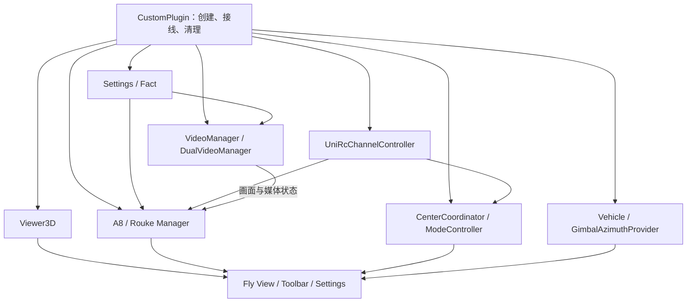
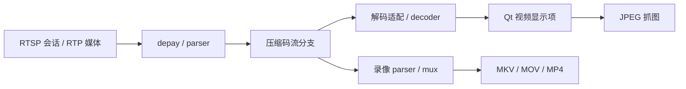
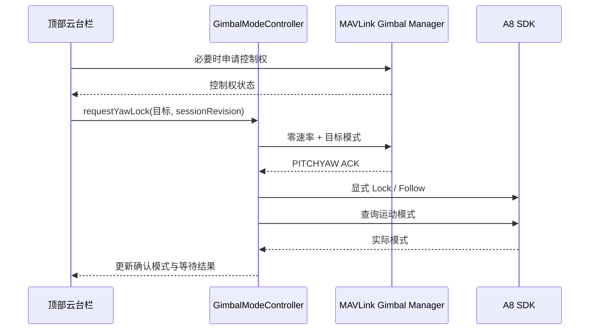

# QGC 二次开发说明

本文说明当前产品的架构、模块设计、实现路径及开发维护方法。阅读时可先从整体对象和数据链路入手，再沿各模块的“入口 → 处理 → 反馈”定位源码。

| 项目 | 内容 |
|---|---|
| 工程 / 分支 | `qgroundcontrol_viewer3d` / `SecDev/rouke` |
| 应用名 | `Custom-QGroundControl` |
| 二次开发目录 | `custom/`，目录层级和文件命名沿用原生 `src/` 的组织方式 |
| 主要技术 | Qt 6 / C++ / QML、MAVLink、GStreamer、Android JNI |
| 文档核对日期 | 2026-11-10 |

## 阅读导航

| 章节 | 回答的问题 |
|---|---|
| [1. 当前实现概览](#progress) | 项目已集成哪些能力，各部分如何协作？ |
| [2. 架构与集成方式](#architecture) | 代码放在哪里，如何构建、初始化和接入原生 QGC？ |
| [3. 功能模块设计与实现](#modules) | 每项功能采用什么设计，具体沿哪些类、方法和资源实现？ |
| [4. 构建、验证与诊断](#verification) | 如何构建当前产品，选择回归检查并采集实机日志？ |
| [5. 开发与维护方法](#maintenance) | 新功能如何落地，review、合并和文档同步检查什么？ |

| 功能分组 | 模块 |
|---|---|
| 场景与画面 | [3.1 三维视图](#viewer3d) · [3.2 双视频与解码](#video) · [3.8 双罗盘](#compass) |
| 相机与操控 | [3.3 A8 Mini](#a8) · [3.4 Rouke](#rouke) · [3.5 本地媒体](#media) · [3.6 云台姿态与模式](#gimbal) · [3.7 UniRC](#unirc) |
| 飞控与遥测 | [3.9 电源与燃料](#power) · [3.10 距离提示](#radar) · [3.11 通信与 USB](#comms) · [3.12 PX4 定制](#px4) |
| 产品配置 | [3.13 设置、布局与翻译](#settings) |

首次接手建议先阅读第 1、2 章，再选择一个模块对照源码。修改某项功能时，先读该模块的实现流程和约束，再根据第 4、5 章完成验证与集成。本文中的源码路径均相对于仓库根目录；构建输出和实机测试记录单独保存。

---

<a id="progress"></a>

## 1. 当前实现概览

本项目以原生 QGC 的 Vehicle、Fact、LinkManager、VideoReceiver 和 QML 界面为基础，通过 `CustomPlugin` 组装产品能力。二次开发围绕三条主线展开：

1. **飞行信息与场景**：保留原生飞控和任务链路，扩展三维场景、双视频、双罗盘、电源和距离提示。
2. **载荷控制与媒体**：分别接入 A8 的 UDP SDK 和 Rouke 的 MAVLink 53022 转发协议，为每路相机维护命令状态、参数和本地媒体会话。
3. **遥控器与产品配置**：接入 UniRC 通道和图传信息，通过 Fact 统一持久化设置，并在 Android 上完成串口、媒体发布和硬件解码集成。

| 模块 | 当前实现 | 与其他模块的关系 |
|---|---|---|
| Viewer3D | OSM 场景、外部三维模型、可选 Google 3D Maps，叠加飞行器和任务 | 接入 Fly View，使用车辆位置、任务和三维设置 |
| 双视频与 PIP | Video 1 / Video 2 独立播放，地图和两路视频切换主辅视图，Android 硬解与逐路恢复 | 主路由原生 VideoManager 管理，第二路由 DualVideoManager 管理 |
| A8 Mini | 倍率、拍照、录像、SD 状态与相机模式查询 | 使用 SiyiSdk；本地媒体绑定 Video 1 |
| Rouke | 视角切换、对焦、回中、拍照、录像，11 项相机/测距参数及通道控制 | 53022 经 AI 盒子转发；本地媒体绑定 Video 2 |
| 本地媒体 | 两路照片和录像、Android 图库发布、容量与退出收尾 | 复用视频接收器和 AndroidMediaLibrary |
| 云台姿态与模式 | 自动申请控制权、共享回中/俯视动作、模式回读与切换 | 对接活动 Vehicle 的云台，以及 A8 SDK |
| UniRC | UART2 / Bluetooth 接收 16 通道和图传信息，驱动 A8 与 Rouke 操作 | 通道策略产生动作意图，再交给相应控制器 |
| 双罗盘 | 飞行器航向和 A8 云台世界方位角 | 区分飞控姿态、云台姿态与当前主画面 |
| 电源与燃料 | 电压、功率、Fuel 详情及发电机母线告警 | 使用 Vehicle Fact 与飞控阈值参数 |
| 距离提示 | 十方向距离及可设置阈值的告警提示 | 使用距离遥测和本地 FlyViewCustom 设置 |
| 通信与 USB | 默认通信配置、Android USB 串口授权和热插拔 | 连接与持久化仍由原生通信框架管理 |
| PX4 定制 | 产品固件插件、模式列表、普通/高级设备设置 | 通过自定义 Factory 接管 PX4 产品行为 |
| 设置与界面 | Fact 设置、响应式布局、中文翻译、Android 默认字号 | 为上述模块提供一致的配置和界面接入方式 |

表中描述源码能力。发布验证按[第 4 章](#verification)记录目标版本、平台、设备和测试结论，避免把实现说明写成逐次测试流水账。

---

<a id="architecture"></a>

## 2. 架构与集成方式

### 2.1 目录组织与职责

<a id="custom-file-tree"></a>

产品业务集中在 `custom/`。C++ 和 QML 按原生模块划分，构建、资源、平台文件及测试分别管理。下面列出开发入口，具体文件之间的调用关系放在第 3 章各模块中。

```text
custom/
├─ CMakeLists.txt                 # 源码、QML 模块、资源、Android overlay、测试目标
├─ cmake/CustomOverrides.cmake    # 产品名、构建开关、固定依赖版本
├─ custom.qrc                    # QML 覆盖、Fact JSON、图标和三维资源
├─ src/
│  ├─ CustomPlugin.h/.cc          # 对象创建、QML 暴露、跨模块接线、退出清理
│  ├─ Settings/                  # FlyViewCustom、VideoCustom 设置
│  ├─ Viewer3D/                  # 三维后端、设置、场景 QML、模型资源和导入样例
│  ├─ VideoManager/              # 第二路视频管理及 GStreamer 策略/适配
│  ├─ Gimbal/                    # A8、Rouke、云台姿态/模式、媒体与相关设置
│  ├─ Android/                   # UniRC 协议/传输/策略和 Android 媒体桥接
│  ├─ Comms/                     # 默认通信配置安装
│  ├─ MAVLink/                   # 团队头文件的编译接口适配
│  ├─ FirmwarePlugin/            # 产品固件 Factory 与 PX4 行为
│  ├─ AutoPilotPlugin/           # 产品设备设置组件
│  ├─ FlightDisplay/             # 飞行页、PIP、相机栏、罗盘和告警
│  ├─ FlightMap/                 # 飞行地图相关资源
│  ├─ QmlControls/               # 指示器、详情页和公共显示控件
│  └─ UI/                        # AppSettings 设置页及 toolbar
├─ android/src/                  # Java overlay：USB 串口、公共媒体库
├─ translations/                 # custom 翻译源及更新脚本
├─ test/                         # 协议/状态测试、界面测试和测试替身
└─ tools/                        # Ubuntu / ADB 实机日志采集脚本及说明
```

日常定位可按以下分工查找：

| 层次 | 负责内容 | 典型入口 |
|---|---|---|
| Settings / Fact | 键名、默认值、范围、持久化和 QML 绑定 | `GimbalControlSettings`、`VideoCustomSettings` |
| QML 页面与控件 | 布局、操作入口、草稿和状态展示 | `RoukeCameraControl.qml`、`RoukeCameraSettings.qml` |
| Manager / Controller | 运行状态、命令排队、会话、超时、跨对象动作 | `RoukeControlManager`、`RoukePayloadController` |
| Policy | 与设备 I/O 分离的判断、转换和动作规则 | `UniRcChannelPolicy`、`GimbalAzimuthPolicy` |
| Protocol / SDK | 字节编解码、帧校验、设备收发 | `RoukeProtocol`、`SiyiSdk` |
| Provider | 整理遥测并提供可绑定的有效值 | `GimbalAzimuthProvider` |
| 平台与适配 | 系统资源、JNI、解码器及原生框架衔接 | `AndroidMediaLibrary`、GStreamer 适配器 |

### 2.2 构建接入与运行生命周期

**构建阶段。** 根 `CMakeLists.txt` 先读取原生 `CustomOptions`，再加载 `custom/cmake/CustomOverrides.cmake`，随后加入 `custom/CMakeLists.txt`。产品覆盖文件确定应用名、MAVLink 版本、测试开关及固件插件策略；custom 构建脚本收集源码、导出库和资源，最终链接到 QGC 主应用。

| 构建入口 | 当前作用 |
|---|---|
| [CustomOverrides.cmake](custom/cmake/CustomOverrides.cmake) | 固定 `Custom-QGroundControl` 和团队 MAVLink 提交；默认关闭测试；使用 custom Viewer3D 与 PX4 Factory |
| [custom/CMakeLists.txt](custom/CMakeLists.txt) | 设置 `CUSTOMHEADER` / `CUSTOMCLASS`，收集 C++，链接 Bluetooth / Quick3D / Quick3DAssetUtils，按能力接入 WebEngineQuick |
| `CustomModule` / `CustomFlightDisplayModule` | 构建 `Custom.Widgets` 和 `Custom.FlightDisplay` QML 模块 |
| [custom.qrc](custom/custom.qrc) | 打包资源和原生 QML 页面覆盖映射 |
| [CustomMAVLink](custom/src/MAVLink/CMakeLists.txt) | 提供团队头文件所需的 gripper 枚举兼容定义，保持现有线值 |

Viewer3D 中公共地形、瓦片、工具和部分 QML 直接复用 `src/Viewer3D/`；有产品差异的实现在 `custom/src/Viewer3D/`。当前产品运行后端为 A8 / Rouke；`Mt11*` 后端源码保留在仓库和独立测试中，但由产品源码列表排除。

**运行阶段。** [CustomPlugin](custom/src/CustomPlugin.cc) 是应用级组装入口。业务对象由插件持有，getter 与 `init()` 共用 `_ensure...()` 方法，先创建设置再创建依赖它的 Manager，保证页面取对象和应用初始化使用同一实例。

| 阶段 | 入口与执行顺序 |
|---|---|
| 插件构造 | 配置 GStreamer/GIO 网络访问策略，准备局域网视频直连 |
| `init()` | 安装默认通信配置和翻译，创建 Viewer3D 设置/管理器并注册类型，再创建姿态、相机、UniRC、视频设置及第二路视频管理器 |
| 对象接线 | 连接共享姿态动作、模式事务、第二路 receiver/item 变化与 Rouke 本地媒体；安装 Android 解码策略和 A8 默认视频配置 |
| `createQmlApplicationEngine()` | 在原生 QML 引擎上安装 `CustomOverrideInterceptor` |
| `createVideoSink()` | 根据 receiver 身份绑定 Video 1 → A8、Video 2 → Rouke，接入分辨率探针和对应恢复观察器 |
| 持续运行 | 各设备收包、Fact 变化、Vehicle 遥测和定时器驱动 Manager；属性与信号更新界面 |
| `aboutToQuit` / `cleanup()` | 取消姿态事务、关闭 UniRC、收尾第二路和两路本地媒体，解除监听、资源拦截器与翻译 |



异步动作以请求编号、目标快照或管线 `generation` 区分会话。对象生命周期由所属 Manager / Plugin 管理；回调还需核对它属于哪次请求或哪条管线。切换端点、车辆或视频源时，旧会话结束，后续状态由新会话更新。

<a id="qml-integration"></a>

### 2.3 QML 资源与 Android 平台接入

**原生页面覆盖。** `CustomOverrideInterceptor` 接收 QML、JavaScript、qmldir 和 URL 资源地址，为原生路径查找 `/Custom` 下的对应资源；文件存在时返回 custom 地址，其余继续加载原生资源。它同时处理 `/qml/`、`/qt/qml/` 和 `/QGroundControl/` 等资源路径形式。

例如，飞行设置页的映射为：

```text
源码：custom/src/UI/AppSettings/FlyViewSettings.qml
QRC 前缀：/Custom/qml
QRC alias：QGroundControl/AppSettings/FlyViewSettings.qml
加载资源：qrc:/Custom/qml/QGroundControl/AppSettings/FlyViewSettings.qml
```

**新增 QML 类型。** 可供原生页面引用的公共新类型登记在 `qt_add_qml_module` 中，并由调用页面显式 import。QRC 负责资源可达，QML 模块负责类型解析，两者在构建时分别声明。

| 模块 / 资源组 | 主要内容 | 调用方式 |
|---|---|---|
| `Custom.Widgets` | Fuel、雷达、UniRC 详情及发电机母线告警 | 页面 import 后创建类型 |
| `Custom.FlightDisplay` | 双 PIP、第二路视频、载荷选择器、相机按钮与图标 | 原生或覆盖页面显式 import，可使用命名空间限定 |
| `/Custom/qml/QGroundControl/...` | 有差异的飞行页、设置页、工具栏及相机面板 | URL 拦截覆盖；部分面板通过明确的 QRC URL 加载 |
| `/qml/Viewer3D/...` | 自定义与复用的三维 QML、模型、材质 | Viewer3D 场景按资源路径加载 |

**Android overlay。** `custom/CMakeLists.txt` 将根 `android/` 模板复制到构建目录，再叠加 `custom/android/`，设置生成目录为 Android 包源。Java 修改以 overlay 文件为准，生成副本只用于构建。

| 文件 | 职责 |
|---|---|
| `custom/android/src/org/mavlink/qgroundcontrol/QGCUsbSerialManager.java` | USB Host 设备枚举、权限、串口打开与 native 回调 |
| `custom/android/src/org/mavlink/qgroundcontrol/QGCCustomMediaLibrary.java` | 公共媒体目录、MediaStore 发布、待完成记录恢复和容量清理 |
| `custom/src/Android/AndroidMediaLibrary.h/.cc` | C++ 与媒体 Java 服务之间的 JNI 接口 |
| `custom/src/Android/UniRcSerialPort.h/.cc` | 板载 UART2 的 POSIX 串口访问 |

overlay 同时补充蓝牙权限等包配置。Android 必须采用源码外构建；新增、删除或修改 overlay 文件后重新配置 CMake。板载 UART2 与 USB Host 串口是两种入口，前者直接打开设备节点，后者由 Android USB 服务授权和管理。

### 2.4 原生接口与模块边界

原生 QGC 提供车辆、参数、任务、通信、视频接收器等基础能力；custom 提供产品地址、设备协议、解码策略、界面和状态编排。review 原生变更时，需同时查看接口定义和 custom 调用点。

| 原生接入位置 | 提供给本产品的能力 | 维护时关注 |
|---|---|---|
| 根 `CMakeLists.txt`、`src/CMakeLists.txt` | 加入 custom、链接资源与 QML 模块、保留 PX4 AutoPilot QML | 模块 URI、链接依赖和构建开关一致 |
| `src/Vehicle/VehicleSetup/VehicleSummary.qml` | 当前固件模块组合下的设备概览 | 与 APM / PX4 构建选择保持一致 |
| `src/VideoManager/VideoManager.h/.cc` | 主/thermal receiver 的启动、停止、重启及 RTSP 退避 | 生命周期与 custom 第二路、恢复策略配合 |
| `src/VideoManager/VideoReceiver/VideoReceiver.h` | URI、generation、编码信息、首帧与错误信号 | 新实现保持统一通知语义 |
| `src/VideoManager/VideoReceiver/GStreamer/GstVideoReceiver.h/.cc` | RTSP、parser/decoder 接入、显示与录像支路 | 通用管线机制与设备策略分工 |
| `src/VideoManager/VideoReceiver/QtMultimedia/QtMultimediaReceiver.cc` | QtMultimedia receiver 的启动通知 | 与公共 receiver 接口一致 |
| `src/Utilities/QGCLogging.cc` | 日志级别过滤 | 诊断分类和实际输出级别一致 |
| `src/Camera/SimulatedCameraControl.cc` | 视频可用状态通知 | `hasVideoChanged` 与模拟相机状态同步 |
| `translations/qgc_json_zh_CN.ts` | 原生参数元数据中文翻译 | 枚举项数、顺序与分隔符一致 |

通用 receiver 负责管线执行；A8 / Rouke 的源分类、硬解候选和恢复判断由 custom 策略负责。页面调用 Manager，协议编码集中在 Protocol / SDK。新增能力优先沿已有职责扩展，涉及原生接口时让变更可以独立说明和 review。

### 2.5 数据链路、连接状态与界面对象

控制、视频和遥控输入分别建立链路。它们共享设备或网络环境，但各自有独立的端点、生命周期和成功条件。

| 链路 | 数据方向与负责人 | 当前状态的依据 |
|---|---|---|
| 飞控 MAVLink | LinkManager / Vehicle 收发遥测、参数与 MAVLink 云台命令 | 车辆连接及对应组件数据 |
| A8 UDP SDK | `SiyiSdk` 与相机端点收发能力、状态和相机命令 | 合法 SDK 回包，见 [3.3](#a8) |
| Rouke MAVLink 53022 | `RoukePayloadController` 独立 UDP → AI 盒子 → 负载；回应反向返回 | 完整且匹配的 Rouke 协议回应，见 [3.4](#rouke) |
| RTSP 视频 | VideoManager / DualVideoManager 从各 RTSP 地址拉流 | source、decoder、sink 状态分别表示收流、解码、显示，见 [3.2](#video) |
| UniRC SDK | Bluetooth 或 UART2 提供 `0x42` 通道和 `0x44` 图传数据 | 通道与图传分别校验、分别超时，见 [3.7](#unirc) |

相机栏的“在线”表示相机控制链路得到设备回应。视频可见与控制在线是两个状态，界面依据动作所需的链路启用控件；设置页允许浏览和编辑草稿，读取、写入的条件由对应 Manager 和页面分别控制。

QML 通过 `QGroundControl.corePlugin` 访问产品对象：

| 属性 | 职责 |
|---|---|
| `viewer3DSettings`、`external3DMapManager` | 三维设置和模型导入；`google3DMapsAvailable` 提供构建能力 |
| `flyViewCustomSettings`、`gimbalControlSettings`、`videoCustomSettings` | 本地产品设置 |
| `dualVideoManager` | 第二路视频接收器、显示项和播放状态 |
| `gimbalControlManager`、`roukeControlManager` | 两种相机的命令、设备状态和媒体会话 |
| `gimbalCenterCoordinator`、`gimbalModeController` | 共享姿态事务及模式同步 |
| `gimbalAzimuthProvider` | 当前 MAVLink 云台的有效方位角与姿态 |
| `uniRcChannelController` | 传输状态、CH1～CH16 和独立 `linkStatus` |

飞行页中，**主辅视图选择**决定地图和视频的显示位置，**相机选择器**决定右侧操作面板，**活动 MAVLink 云台**由 Vehicle 的 GimbalController 管理。三者各有职责；本地媒体按 Video 1 / A8、Video 2 / Rouke 的产品绑定取帧。

---

<a id="modules"></a>

## 3. 功能模块设计与实现

各节按设计职责、实现流程、配置和状态规则组织，最后列出关键源码入口。涉及共享机制时链接对应章节，避免在多个模块重复维护同一流程。

<a id="viewer3d"></a>

### 3.1 Viewer3D 三维飞行视图

#### 3.1.1 设计与职责

三维模块在飞行页增加独立视图入口，复用原生 Vehicle、任务控制器和部分 Quick3D 资源，在 `custom/` 中实现地图源选择、地理配准及场景组合。设置入口为“应用设置 → 飞行视图 → 3D View”，飞行工具条通过“3D View / Fly”切换页面。

| 地图源 | 渲染与内容 | 接入条件 |
|---|---|---|
| 本地 OSM | Quick3D 建筑、瓦片地表、F450 飞行器和任务航线 | OSM 文件；在线地表瓦片还需地图源和网络 |
| 外部模型 | OBJ/glTF/GLB 或 Quick3D QML 模型，共用本地飞行器/任务叠加 | 模型及材质纹理、WGS84 原点、模型单位和北向 |
| Google 3D | WebEngine 中的在线三维地图 | 构建包含 WebEngineQuick、有效 API Key、网络 |

地图源按 **Google → 外部模型 → OSM** 选择。Google 使用独立 WebEngine 页面，当前不叠加本地 Quick3D 飞行器和航线；未编入 WebEngine 时由 `Google3DMapUnavailable.qml` 提示。OSM 和外部模型共用同一个局部坐标系及车辆组件。

#### 3.1.2 入口、地图加载与场景更新

`Viewer3D.qml::open()` 启用管理器 Loader 并设置 `isOpen`；管理器和视图都加载完成后，`_bindLoadedView()` 将管理器交给场景。普通 `close()` 隐藏视图，关闭三维功能设置时同时停用管理器 Loader。`CustomViewer3DManager::registerQmlTypes()` 将 C++ 管理器注册为 QML 类型 `QGroundControl.Viewer3D/Viewer3DManager`，并注册坐标、建筑和地形类型；管理器持有 `Viewer3DQmlBackend` 和 `OsmParser`。

**OSM 加载链路**

1. `CityMapGeometry::setOsmFilePath()` / `loadOsmMap()` 接收文件设置，将解析任务交给 `OsmParser`。
2. `OsmParser::parseOsmFile()` 调用原生 `OsmParserThread` 读取节点、建筑轮廓和属性；`osmParserFinished()` 发布地图边界、GPS 参考点和 `mapChanged`。
3. `buildingToMesh()` 以建筑 `height` 或 `levels × buildingLevelHeight` 决定高度，对外轮廓与内孔三角化，生成屋顶、底面和墙面。缺少高度信息的建筑不生成 mesh。
4. `CityMapGeometry::updateViewer()` 将顶点数据提交给 `QQuick3DGeometry`。地表由原生 `Viewer3DTerrainTexture` 下载并拼接瓦片，完成后将 ROI 和瓦片数量交给 `Viewer3DTerrainGeometry::updateEarthData()`，由 `buildTerrain_2()` 生成顶点、法线和 UV。
5. `Viewer3DModel.qml` 组合建筑、地表材质、相机和交互处理器。建筑与地表采用每米 10 个场景单位，与车辆和任务图元统一。

**外部模型加载链路**

设置页调用 `External3DMapManager::importModelFile()`。OBJ/glTF/GLB/QML 直接更新文件 Fact；FBX/DAE/STL/PLY 由 `_startBalsamConversion()` 启动 Qt Balsam，转换完成且找到生成的 QML 后，`_completeBalsamConversion()` 更新文件 Fact。状态通过 `importingChanged`、`lastImportStatusChanged` 返回设置页。

`External3DMap.qml` 对 OBJ/glTF/GLB 使用 `RuntimeLoader`，对 QML 使用 `Loader3D`，在共同父 Node 上应用单位换算、缩放和 yaw。`Viewer3DModel.qml::mapGeometryLoader` 选择 OSM 或外部模型，车辆和任务保持独立 Loader，因此切换本地地图源不改变叠加逻辑。

Balsam 工具依次从 `QGC_VIEWER3D_BALSAM`、应用目录、Qt Kit 的 bin 目录和 PATH 查找；输出位于应用数据目录的 `Viewer3DExternalMaps/<名称>_<路径哈希>/`。同一时刻执行一个转换任务。OBJ 导入应保留 MTL 和纹理的相对路径；模型转换工具需随运行环境提供。

**车辆和任务更新**

`Viewer3DQmlBackend::init()` 连接地图设置、OSM 的 `gpsRefChanged` 和活动车辆变化。`_restoreBestGpsRef()` 选择有效外部模型原点，其次使用 OSM 参考点，最后使用车辆坐标。外部模型模式固定使用模型原点。

`Viewer3DModel.qml` 通过 `Repeater3D` 为各车辆创建 `Viewer3DVehicleItems` 及对应的 `PlanMasterController`。`GeoCoordinateType` 将 WGS84 坐标转换为局部 ENU；`DroneModelDjiF450.qml` 绑定车辆位置、姿态和飞行状态，驱动机体与桨叶。任务集合、参考点或 Home 改变时，`addMissionItemsToListModel()` 和 `addSegmentToMissionPathModel()` 重建航点与航段。当前 `isItemAcceptable()` 支持 Waypoint、RTL、Takeoff、ROI（含兼容命令）；增加任务类型时需同时补充标记及高度处理。

Google 模式由 `Google3DMapView.qml::_buildGoogle3DHtml()` 生成页面，`reloadGoogle3DMap()` 调用 WebEngine `loadHtml()`。中心点优先取活动车辆，再取二维地图中心；150 ms 单次定时器合并加载请求，签名相同不重复加载。该页面在打开或切换车辆时重新评估中心，不按车辆每帧位置重载。

#### 3.1.3 配置与地理配准

以下设置保存在 `Viewer3D` 分组，元数据位于 `Viewer3D.SettingsGroup.json`。

| 设置键 | 默认值 | 作用 |
|---|---|---|
| `enabled` | false | 启用三维入口 |
| `useGoogle3DMapSource` / `google3DMapsApiKey` | false / 空 | 在线地图与密钥 |
| `useExternal3DMapSource` / `external3DMapFilePath` | false / 未选择 | 外部模型与文件 |
| `external3DMapOriginLatitude/Longitude/Altitude` | 0 / 0 / 0 | 模型原点的 WGS84 纬经度及 AMSL 海拔（m） |
| `external3DMapUnitToMeters` / `external3DMapScale` | 0.01 / 1 | 米/模型单位及附加比例 |
| `external3DMapYaw` | 0° | 0° 表示模型 +X 向东、+Y 向北 |
| `osmFilePath` / `buildingLevelHeight` | 未选择 / 3 m | OSM 文件与缺省层高 |
| `altitudeBias` | 0 m | 飞机、航点、航段共同的显示高度偏移 |

外部模型使用以下换算：

```text
模型场景缩放 = 米/模型单位 × 附加比例 × 10
车辆显示高度 = (车辆 AMSL - 模型原点 AMSL + altitudeBias) × 10
任务显示高度 = (任务 amslEntryAlt - 模型原点 AMSL + altitudeBias) × 10
```

模型原点海拔使用绝对海拔；车辆或任务缺少 AMSL 时，组件按当前相对/任务高度后备值显示。配准时先确认单位和高度来源，再调整 yaw 和显示偏移。`altitudeBias` 统一传入飞机、航点和航段，新增三维叠加应沿用同一参考点及尺度。

[仓库样例](custom/src/Viewer3D/ExternalWGS84_UE5_MapSample/README.md) 的 `realistic_town_wgs84_map.obj` 使用米制 ENU：原点 `37.4456, -122.1616, 9.0 m AMSL`，单位比例 1、附加比例 1、yaw 0°、高度偏移 0。样例 JSON 提供人工填写参数，导入接口接收模型文件路径。样例资源不进入 APK/QRC。

#### 3.1.4 源码导航与扩展位置

| 修改目标 | 主要文件（相对 `custom/src/`） |
|---|---|
| 飞行页入口与视图生命周期 | `FlightDisplay/FlyView.qml`、`FlyViewToolStripActionList.qml`；`Viewer3D/Viewer3DQml/Viewer3D.qml` |
| 参数、设置页与文件导入 | `Viewer3D/Viewer3DSettings.h/.cc`、`Viewer3D.SettingsGroup.json`、`External3DMapManager.h/.cc`；`UI/AppSettings/Viewer3DSettingsGroup.qml` |
| 类型注册与地图坐标基准 | `Viewer3D/CustomViewer3DManager.h/.cc`、`Viewer3DQmlBackend.h/.cc` |
| OSM 和地表几何 | `Viewer3D/OsmParser.cc`、`CityMapGeometry.cc`、`Viewer3DTerrainGeometry.cc`；原生 `src/Viewer3D/` 的线程、瓦片和 shader |
| 场景、外部模型及任务叠加 | `Viewer3D/Viewer3DQml/Models3D/Viewer3DModel.qml`、`External3DMap.qml`、`Viewer3DVehicleItems.qml` |
| 飞行器模型与在线地图 | `Viewer3D/Viewer3DQml/Drones/DroneModelDjiF450.qml`、`Djif450/`；`Google3DMapView.qml`、`Google3DMapUnavailable.qml`（后两项位于 `Viewer3DQml/`） |

增加地图源时，先定义设置和坐标基准，再接入地图 Loader；车辆/航线继续使用共同 backend。增加资源或类型时同步 `custom/CMakeLists.txt`、`custom/custom.qrc` 和相关 `qmldir`，确保部署路径与 QML 引用一致。

---

<a id="video"></a>

### 3.2 双视频、PIP 与 Android 解码

#### 3.2.1 设计与对象关系

视频层为 Video 1、Video 2 分别建立 receiver、解码器和显示项。主路沿用原生 `VideoManager`，第二路由 `DualVideoManager` 管理。地图与两路视频交给 `DualPipView`，其中一项作为主画面，其余作为上下两个 PIP 小窗；支持交换、收起、同步缩放及桌面独立窗口。

产品的相机和本地媒体绑定固定为 **Video 1 → A8 Mini、Video 2 → Rouke**。PIP 切换只调整布局，不交换 receiver、SDK 对象或保存目录。视频地址与相机控制端点独立，视频播放状态和控制通信在线状态分别维护。

```text
CustomPlugin
├─ 原生 VideoManager → 主路 receiver/sink → A8 媒体接口
└─ DualVideoManager  → 第二路 receiver/sink → Rouke 媒体接口

FlyView → DualPipView（地图、Video 1、Video 2）→ 主画面 / PIP / 独立窗口
```

#### 3.2.2 配置与启动流程

| 设置 | 默认值 / 行为 |
|---|---|
| `Video/rtspUrl` | 默认安装器为主路补入 `rtsp://192.168.144.25:8554/main.264` |
| `Video/secondaryRtspUrl` | `rtsp://192.168.144.100:8554/live`；留空关闭第二路 |
| 原生 `Video/rtspTimeout` | A8 默认地址初始化时至少为 20 s |
| 原生 `Video/lowLatencyMode` | Android A8 默认配置中，未保存过该项时设为 true |
| `GimbalControl/mavlinkAutoVideoStream` | false；关闭时保留手工视频源，修改后重启 |
| `GimbalControl/forceAndroidH265HardwareDecoder` | true；控制 Android H.264/H.265 厂商硬解策略，修改后重启 |

设置入口在“应用设置 → Video”。`GimbalVideoStreamSupport::installA8MiniDefaults()` 按版本标记安装主路默认值，保留用户已配置的其他 URL。自动视频流关闭时，`CustomPlugin::mavlinkMessage()` 通过 `shouldFilterMavlinkMessage()` 过滤 `VIDEO_STREAM_INFORMATION`，实际播放仍由 VideoManager 根据设置启动。

第二路要求原生源为 RTSP、视频总开关开启、第二路 URL 非空且不重复占用主路源。`DualVideoManager` 按以下顺序协调启动：

| 阶段 | 入口 | 处理 |
|---|---|---|
| 读取期望配置 | `_refreshSettings()` | 计算 enabled、URI 和重复源状态，监听源地址、视频开关及低延迟设置 |
| 绑定显示项 | `initVideoItem(window, videoItem)` | 接收 QML 窗口与视频项，建立窗口生命周期关系 |
| 创建接收对象 | `_ensureReceiver()` | 经 corePlugin 创建 receiver/sink，连接启停、首帧、尺寸、录像、错误和销毁信号 |
| 等待图形资源 | `_scheduleRenderInitialization()` → `_finishRenderInitialization()` | 在窗口渲染生命周期中初始化，完成后回到 Manager 协调启动 |
| 执行启停 | `_applyDesiredState()` / `_requestStop()` | 比较当前与期望状态；旧会话停止完成后启动新会话 |
| 记录本次管线 | `videoPipelineGenerationStarted` | 固定当前 URI 和 generation，清空上一代首帧事实 |
| 接收与解码启动 | `onStartComplete` / `onStartDecodingComplete` | 分别确认流接收和解码启动，启动首帧观察 |
| 失败重试 | `_scheduleRestart()` → 定时器 → `_applyDesiredState()` | 退避后重新检查当前设置，发起下一次连接 |

`setPrimaryVideoReceiver()` 订阅主路启动、停止和销毁，跟踪配置中、启动中、活动中及释放中的 URI，使重复源检查覆盖整个交接过程。低延迟模式属于管线启动配置；修改后通过同一停止/重建路径生效，用户暂停状态保持不变。

`CustomPlugin::createVideoSink()` 根据 receiver 所有者区分主路和第二路，并排除原生 thermal 支路。主路接入 A8 的 `setMainVideoItem()` / `setMainVideoReceiver()`，第二路接入 Rouke 的 `setVideoItem()` / `setVideoReceiver()`；录像启动结果返回各自 Manager。`PulledVideoResolutionProbe` 把协商得到的真实视频尺寸送至对应媒体模块。

释放第二路时，`videoObjectsAboutToBeReleased` 先通知 Rouke 停止本地媒体并解绑，`videoObjectsReleased` 再调用 `finalizeDetachedLocalMedia()` 完成收尾。修改 receiver/sink 所有权时，应一起检查这组媒体通知。

#### 3.2.3 RTSP、编码格式与硬件解码

单路视频的公共接收与分支结构如下；本地录像从压缩数据分支封装文件，本地照片从解码后的显示项抓取。



RTSP 用于会话建立与控制，视频以 RTP 负载传输。`hvc1`、`avc` 和 `byte-stream` 则是解包后 NAL 单元的组织格式。当前两款负载的现场配置如下，分辨率/profile 会随设备设置变化：

| 层次 | A8 Mini | Rouke |
|---|---|---|
| RTSP 地址 | `rtsp://192.168.144.25:8554/main.264` | `rtsp://192.168.144.100:8554/live` |
| 实际编码 | H.265 / HEVC | H.264 / AVC |
| 已采集画面规格 | 1920×1080，Main / Level 4 | 1280×720，High / Level 3.1 |
| 网络媒体封装 | RTP H.265，`encoding-name=H265` | RTP H.264，`encoding-name=H264` |
| 已采集传输方式 | `RTP/AVP;unicast`，RTP/RTCP 经 UDP | `RTP/AVP;unicast`，RTP/RTCP 经 UDP |
| QGC 解包/解析后的格式 | `video/x-h265, hvc1, alignment=au` | `video/x-h264, avc, alignment=au` |
| 厂商硬解前的适配 | `hvc1/AU → h265parse → byte-stream/AU` | `avc/AU → h264parse → byte-stream/AU` |

A8 服务路径的 `.264` 后缀不决定编码，实际编码由 SDP/CAPS 确认。`alignment=au` 表示按访问单元组织；`byte-stream` 为 Annex-B 起始码形式，`avc/hvc1` 使用长度前缀。转换改变封装，不重新编码视频。

网络接收使用 `rtspsrc` 的 Auto 协商，允许 UDP 单播、UDP 组播和 TCP 内嵌 RTP；最终方式由服务端和网络共同决定。GIO 默认直连，需要系统代理时设置启动环境变量 `QGC_GST_USE_SYSTEM_PROXY=1`。同 URI 的 OPTIONS EOF 由原生 receiver 进入基本头部、跳过 OPTIONS 的有限兼容流程。失败重连按 1/2/4/8/15 s 退避，成功解码/显示后复位失败计数。

视频与控制共享图传时，发送端视频码率、无线链路容量和队列调度共同决定控制延迟。QGC 的控制 UDP 与 RTP 使用独立 socket；接收端调大缓冲只能吸收短时突发，不能恢复上游已丢弃的报文。带宽保障应在瓶颈发送出口实施：对视频设总码率上限，给控制流量设置优先队列和最低保障，并按实际可用吞吐留余量。90%/10% 可作为队列配置比例，但不是 QGC 能单独分配的无线信道资源，也不是固定链路容量的保证。

RTSP/RTP over TCP 可用于与 UDP 做对照，前提是服务端支持 interleaved TCP；可靠传输和拥塞控制可能改善丢包，同时可能增加等待和画面延迟。当前 UI 没有强制传输方式开关。实现 TCP-only 配置时应保持 `rtsp://` 地址，在对应 `rtspsrc` 上通过 `protocols` 限制为 TCP，并核对 SETUP 的实际 Transport；仅修改 URL scheme 会影响当前按 `rtsp/rtsps` 分类的恢复策略。接口说明见 [GStreamer rtspsrc](https://gstreamer.freedesktop.org/documentation/rtsp/rtspsrc.html)，拥塞与队列原则见 [RFC 8085](https://www.rfc-editor.org/rfc/rfc8085.html) 和 [RFC 4594](https://www.rfc-editor.org/rfc/rfc4594.html)。

**Android 解码适配层**

`AndroidVideoDecoderPolicy::apply()` 在 GStreamer 初始化后、decodebin 创建前建立厂商 MediaCodec 候选并注册两个适配器。硬解开关开启时，候选限定为符合条件的厂商解码器；关闭后使用原生自动选择。当前 Android 静态构建需包含 `androidmedia` 插件。

| 适配器 | 接收的压缩格式 | 内部连接及厂商输入 |
|---|---|---|
| `qgcandroidh264hwdec` | `avc/AU`、`avc3/AU`、`byte-stream/AU` | h264parse → byte-stream/AU/parsed CAPS → 厂商 AVC 解码器 → 有界 raw 队列 |
| `qgcandroidh265hwdec` | `hvc1`、`byte-stream/AU` | h265parse → 规范化 byte-stream/AU CAPS → 厂商 HEVC 解码器 |

H.264 适配器设置 `config-interval=-1`、`disable-passthrough=true`，在 IDR 处重发 SPS/PPS；H.265 适配器规范化 CAPS 并重发参数集。原生 `GstVideoReceiver` 的 H.265 byte-stream 输入门控等待同一访问单元的 SPS/PPS/有效 IRAP，保留可选 VPS。未知帧率按协商处理。适配只位于解码分支，录像分支继续使用其原压缩数据。

以上是本项目适配器声明和当前遥控器插件的接口范围。实际解码还受芯片支持的 profile、分辨率和双路并发能力约束；H.265 适配器当前未声明 `hev1` 输入。新增遥控器型号时，应从其厂商 factory 和 sink CAPS 确认输入契约，再调整适配器。

#### 3.2.4 状态观察与恢复

恢复判断按 **receiver + URI + generation** 关联，网络接收、解码输出和显示分别记录。主路观察者为 `AndroidVideoDecoderRecovery`，第二路在 `DualVideoManager` 中实现。

| 信号 / 状态 | 含义与用途 |
|---|---|
| 第二路 `enabled` / `hasVideo` | 源配置允许工作 / 配置完整且无重复源，用于界面布局和启动条件 |
| `streaming` / `decoding` | 接收器报告接收与解码状态，用于媒体和启停协调 |
| `sourceFrameReceived` | 压缩媒体已进入管线 |
| `videoDecoderSelected` | 实际 codec、插件及 factory 已确定 |
| `decoderFrameReceived` | 解码器已输出帧 |
| `sinkFrameReceived` | 显示链已取得帧，结束首帧等待 |
| `onVideoPipelineError` | 携带错误分支及本代进展，用于选择恢复动作 |

H.265 的输入格式与候选恢复由 `AndroidH265DecoderFallback` 保存逐路状态，`AndroidH265DecoderRoutePolicy` 给出候选顺序。首帧超时、明确的 decoder 分支错误或解码启动失败调用 `prepareHardwareRetry()`；同 URI 已确认 H.265、仅有 CAPS 尚无输入/输出帧时，原生 timeout 回调可通过 `prepareCapsOnlyTimeoutRetry()` 允许下一代一次格式切换。输入格式变更重建该格式下的尝试状态，URI 变更清理旧路由。每路独立推进候选，硬解模式下不自动改用软件解码。

**图形资源恢复**：第二路监听实际窗口的 `sceneGraphInvalidated/sceneGraphInitialized`。失效事件排队回 GUI 线程，先停止并释放 receiver/sink，再用 `renderItemEnabled` 卸载旧 QML GL 显示项；同一有效窗口的场景图恢复后创建新项及接收器。窗口与初始化代次用于匹配异步回调。普通同窗口 PIP 切换保留现有视频对象，用户暂停状态在恢复过程保留。

**A8 播放后停滞恢复**：`A8RtspStreamRecovery::install()` 按 A8 端点匹配会话，安装 RTP、解析后媒体和 RTCP 探针，周期调用 `A8RtspRecoveryPolicy::evaluate()`。前台、未录像且已显示的会话在媒体停滞 6 s 时可重建；近期时钟跳变伴随 RTP/媒体同时停止时使用 2 s 条件。每代最多触发一次，同 URI 每 60 s 最多两次；该策略用于 A8 已播放后的停滞，首帧阶段由解码观察者负责。

#### 3.2.5 PIP 布局与交互实现

`FlyView.qml` 将地图、Video 1、Video 2 交给 `DualPipView.item1/item2/item3`。`_itemKey()` 用 `map/video1/video2` 标识内容，`_initializeLayout()` 读取 `MainFlyWindowView`，`_reconcileLayout()` 在可用项变化时保留有效主画面与辅槽。

点击辅窗后，`_activateSlot()` 把该内容置为 fullState，再把原主画面放回同一辅槽；`_applyLayout()` 统一更新各项 pipState。adapter 负责内容在上下辅槽及独立窗口之间的绑定，`_showWindow()` 和窗口关闭回调完成弹出/回收。`_setPipIsExpanded()` 将展开状态保存到 `IsPIPVisible`。

两个辅窗共享 `_pipSize`，保持单窗 16:9。拖动任一右上角手柄时，将指针通过 `mapToItem(root.parent, ...)` 映射到统一父容器，按按下时宽度与累计水平位移更新尺寸；宽度限制为父容器的 10%～75%。缩放直接改变容器几何，不重建视频管线。

#### 3.2.6 源码导航与维护约定

| 修改目标 | 主要文件（相对 `custom/src/`） |
|---|---|
| 主辅画面布局与交互 | `FlightDisplay/FlyView.qml`、`DualPipView.qml` |
| 第二路显示项、PipState 和窗口 | `FlightDisplay/FlyViewSecondaryVideo.qml`、`FlightDisplayViewSecondaryVideo.qml` |
| 第二路生命周期与主路接线 | `VideoManager/DualVideoManager.h/.cc`、`CustomPlugin.cc` |
| 视频配置 | `Settings/VideoCustomSettings.h/.cc`、`VideoCustom.SettingsGroup.json`；`UI/AppSettings/VideoSettings.qml`；`Gimbal/GimbalVideoStreamSupport.h/.cc` |
| 厂商解码初选与封装适配 | `AndroidVideoDecoderPolicy`、`AndroidH264HardwareDecoderAdapter`、`AndroidH265HardwareDecoderAdapter`、`AndroidH265DecoderCapsPolicy` |
| H.265 候选与首帧恢复 | `AndroidH265DecoderRoutePolicy`、`AndroidH265DecoderFallback`、`AndroidVideoDecoderRecovery` |
| A8 播放停滞恢复及源尺寸 | `A8RtspRecoveryPolicy`、`A8RtspStreamRecovery`、`PulledVideoResolutionProbe` |

最后三行文件均位于 `VideoManager/VideoReceiver/GStreamer/`，各有 `.h/.cc`。原生 `src/VideoManager/` 提供通用 receiver 和主路管理。

修改公共首帧/错误信号时同时检查两路观察者；修改 URL 或接收器绑定时同步检查媒体会话收尾。验收依次确认协商格式、source 帧、decoder 帧、sink 帧及双路持续播放，配置可用状态用于启动协调，不作为实际出画面的依据。相关回归位于 `custom/test/VideoManager/VideoReceiver/GStreamer/` 和 `custom/test/FlightDisplay/DualPipResizeTest.py`。

---

<a id="a8"></a>

### 3.3 SIYI A8 Mini 相机

#### 3.3.1 设计与职责

A8 对应 Video 1。右侧相机栏提供目标倍率显示、短按步进、长按连续变倍、拍照和单按钮录像启停；设备控制使用 SIYI 私有 UDP SDK，不依赖活动飞行器。拍照、录像可同时保存到设备 SD 卡和本机，两条结果分别维护，本地媒体流程见 [3.5](#media)。顶部 MAVLink 云台姿态与模式控制见 [3.6](#gimbal)。

业务分为四层：

| 层次 | 对象 | 职责 |
|---|---|---|
| 交互 | `GimbalCameraControl.qml`、`GimbalZoomControl.qml` | 展示能力和状态，识别短按/长按，管理指针及面板生命周期 |
| 业务状态 | `GimbalControlManager` | 维护设备在线、倍率能力、目标与实测值、动作所有者、照片及录像会话 |
| 目标计算 | `A8MiniZoomPolicy`、`ZoomStepPolicy` | 根据卡录能力与步长生成合法档位、精确终点和按压时间对应的目标 |
| 传输协议 | `SiyiSdk`、`SiyiProtocol` | 管理 UDP 端点和查询，编码命令、校验帧并将有效回复转换为业务信号 |

`CustomPlugin` 创建 Manager 并连接主路视频对象。飞行页的 `FlyViewTopRightColumnLayout.qml` 通过选择器加载 A8 或 Rouke 面板，每个 Loader 实例固定绑定其对应 Manager。两路一级栏共用双列宽度、矢量图标、录制反馈和 SD 状态组件；可用高度不足时由外层滚动区域容纳，按钮保持最小触控尺寸。

#### 3.3.2 配置与能力建立

设置入口为“应用设置 → 飞行视图 → 云台相机 → SIYI A8 Mini”。下表各项由 `GimbalControlSettings` 的 Fact 持久化。

| 设置键 | 默认值 | 作用 |
|---|---|---|
| `enabled` | true | 启用 A8 SDK 与相机栏 |
| `sdkHost` / `sdkPort` | `192.168.144.25` / 37260 | SIYI UDP 端点 |
| `zoomStep` | 1.0x | 短按步长与长按目标分档；范围 0.1～4.5x，按 0.1x 量化 |
| `uniRcZoomDirectionReversed` | false | 仅反转 UniRC CH9，触控方向不变 |
| `localMediaStorageEnabled` | true | 拍照、录像同时使用本机媒体支路，两路相机共用此设置 |

Manager 的构造函数集中连接 Fact、SDK 信号、视频生命周期和定时器。`_settingsChanged()` 配置端点并重置对应状态；启用后立即查询，随后 `_pollSdk()` 约每 2 s 查询卡录参数 `0x20`、设备最大倍率 `0x16`、相机状态 `0x0A`，在没有专用变倍查询占用时补充当前倍率 `0x18`。

变倍需要同时建立两类能力：

1. **当前视频会话可用**：`setNegotiatedPulledVideoResolution()` / `_handlePulledVideoSize()` 将当前 receiver 的尺寸送入 `_tryConfirmPulledVideoResolution()`。支持的拉流尺寸为 1920×1080、1280×720；视频停止或换会话后重新确认。
2. **相机卡录倍率范围已知**：`_handleRecordingStreamParameters()` 解析 `0x20` 的卡录尺寸，`_refreshMaximumZoomCapability()` 计算上限；有效 `0x16` 上限可以进一步收紧范围。卡录能力 4.5 s 未刷新时失效。

| 卡录尺寸 | `A8MiniZoomPolicy` 对应倍率上限 |
|---|---|
| 3840×2160 或 4096×2160 | 1.0x |
| 2560×1440 | 3.5x |
| 1920×1080 | 5.5x |
| 1280×720 | 6.0x |

`zoomControlsUnlocked = enabled && videoStreamAvailable && maximumZoomKnown`。QML 还检查 `sdkResponding`、方向是否到达端点及当前手势状态。卡录尺寸决定相机能力，拉流尺寸决定当前视频会话是否可用，两者分别维护。

#### 3.3.3 变倍实现流程

```text
GimbalZoomControl 的触控手势 / UniRC CH9
    → GimbalControlManager：动作所有者、目标规划、能力检查
    → A8MiniZoomPolicy / ZoomStepPolicy：合法目标
    → SiyiSdk → SiyiProtocol → UDP
    ← 0x0F 命令反馈 / 0x18 实测倍率
    ← Manager 更新目标、实测值和等待状态 → QML
```

**短按步进**

1. 按压未达到 420 ms 时，释放触发 `zoomIn()` / `zoomOut()` → `_sendZoomStep(direction)`。
2. `_zoomPlanningReference()` 选择当前规划参考；`stepTarget()` 从以 1.0x 为起点的档位表中选择下一档。内部采用十分之一倍率整数，能力上限即使不落在完整步长上也作为合法终点。
3. `_sendAbsoluteZoomTarget()` 校验目标，调用 `SiyiSdk::sendAbsoluteZoom()` 发送 `0x0F`。本地写出成功后立即更新目标显示。
4. `_handleAbsoluteZoomFeedback()` 接收命令反馈；专用查询经 `_handleCurrentZoom()` 获取 `0x18` 实测值。`TargetTracker` 以合法目标的精确匹配完成到位校验，查询和整个操作各有截止时间。

例如卡录 1080P、步长 1.0x 时，档位为 `1 / 2 / 3 / 4 / 5 / 5.5`，反向从 5.5x 返回 5.0x。连续短按以上一次已提交目标规划，后续显示由最新动作持有。

**长按连续运动**

| 阶段 | 实现入口 | 行为 |
|---|---|---|
| 开始 | QML `beginHeldZoom()` → `startZoomWithPressDuration()` | 达到 420 ms 后进入长按；记录按下时的 Manager、方向、起点和总按压时长 |
| 运动 | `_startZoomWithPressDuration()` → `sendManualZoom()` | `0x05` 发送 -1/1；`_pollContinuousZoom()` 查询运动进展 |
| 目标显示 | `_advanceHeldZoomDisplayTarget()` → `heldTarget()` | 按总按压时长及 600 ms 分档周期更新目标，限制在合法范围 |
| 正常释放 | `stopZoom()` → `_stopContinuousZoom()` | 发送 `0x05` 零速，回读并完成目标收尾 |
| 生命周期取消 | `cancelZoomGesture()` → `cancelZoom()` / `_stopContinuousZoomForSafety()` | 隐藏、失焦、换 Manager、SDK 失联或视频失效时释放动作，不再推进显示目标 |
| 停止发送 | `_sendPendingManualZoomStop()`、`_retryManualZoomStop()` | 保存原端点，管理停止写出及延迟停止副本，在新动作前处理遗留停止状态 |

UniRC 的 `startUniRcZoom()`、`stopUniRcZoom()`、`cancelUniRcZoom()` 使用相同能力和协议通路，但有独立动作所有者。触控释放仅结束自身持有的动作，不会结束已由 CH9 接管的运动。每次手势固定捕获 Manager，切换相机后仍能向原 A8 对象完成取消。

界面倍率表示**控制目标**；`0x18` 是**实测倍率**，用于初始化、到位判断和停止后校验。维护目标显示时应保留这两个来源，避免中间运动反馈覆盖用户刚提交的新目标。

#### 3.3.4 拍照、录像与状态反馈

| 业务 | 协议与反馈 | Manager / UI 行为 |
|---|---|---|
| 拍照 | `0x0C` 拍照，`0x0B` 功能反馈 | `takePhoto()` 发设备动作并尝试本地截图；成功反馈增加设备照片计数，界面据此闪烁 |
| 录像启停 | `0x0C` 为设备端切换命令；`0x0A` 查询录像状态 | `toggleVideoRecording()` 维护明确目标意图，发送后延迟 400 ms 回读；有效状态匹配目标才结束等待，命令窗口 2.5 s |
| 相机在线 | 有效 SDK 业务回复 | `packetReceived` 刷新响应状态；轮询无有效回复时置为未响应 |
| SD 插卡提示 | `0x0A` 的 `record_sta` | 1 确认有卡；2 确认无卡；0（停止）及 3（视频数据丢失）为未确认；状态有效期 5 s |

`SiyiSdk::_readPendingDatagrams()` 检查来源 IP，`SiyiProtocol::decodeDatagram()` 拆解同一 UDP 内的完整帧并校验长度、CRC、ACK；`_dispatchAck()` 在 payload 合法后先发 `packetReceived`，再发对应业务信号。模式查询采用独立 socket 与 requestId，具体流程见 3.6。

录像由三个不同属性表达：`recordingSessionActive` 表示存在录制或待收尾会话；`cameraRecordingPending` / `localRecordingPending` 表示等待；`recordingSessionCapturing` 表示设备状态已确认录制或本地已实际采集。主栏红色及计时只依赖实际采集，待确认与失败使用各自提示。设备 SD 与本地录像分别收尾，文件处理见 3.5。

一级栏普通拍照、开始录像和变倍要求 `enabled && sdkResponding`，离线时灰显。已有录像会话保留停止入口，并继续遵守 `videoRecordingAvailable`。SD 圆点绿色仅表示 `sdCardStatusKnown && sdCardInserted`；明确无卡或尚未确认均用红点，具体区别由提示文字表达。端点变化、禁用和状态过期使旧 SD 状态失效。

#### 3.3.5 源码导航

下表路径均相对于 `custom/src/`，原生接口单独标明。

| 文件 / 入口 | 阅读与修改范围 |
|---|---|
| `CustomPlugin.cc` | `_ensureGimbalControlManager()`、主路视频对象与本地媒体回调的连接 |
| `UI/AppSettings/GimbalControlSettingsGroup.qml`；`Gimbal/GimbalControlSettings.h/.cc`、`GimbalControl.SettingsGroup.json` | 应用设置入口、Fact 定义、默认值及持久化 |
| `FlightDisplay/FlyViewTopRightColumnLayout.qml`、`CameraPayloadSelector.qml` | 面板选择、Manager 绑定和整栏滚动 |
| `FlightDisplay/GimbalCameraControl.qml`、`GimbalZoomControl.qml` | 双列主栏、手势捕获、目标/实测倍率、录制状态展示 |
| `FlightDisplay/CameraControlIcon.qml`、`CameraStorageStatus.qml` | 共享矢量图标及 SD 状态表示 |
| `Gimbal/GimbalControlManager.h/.cc` | 从构造函数查看连接关系；按 `_pollSdk()`、`_sendZoomStep()`、`_startZoomWithPressDuration()`、`_handleCurrentZoom()` 追踪完整控制流程 |
| `Gimbal/A8MiniZoomPolicy.h/.cc`、`ZoomStepPolicy.h/.cc` | 分辨率能力、合法档位与长按目标计算 |
| `Gimbal/SiyiSdk.h/.cc`、`SiyiProtocol.h/.cc` | UDP、普通/模式查询通道、帧编码和 payload 解析 |
| `Gimbal/GimbalMediaSessionPolicy.h/.cc`、`GimbalPhotoCapturePolicy.h/.cc` | 录制可用性、会话状态及照片捕获策略；存储协作见 3.5 |

---

<a id="rouke"></a>

### 3.4 柔克负载（MAVLink 53022）

#### 3.4.1 设计与职责

Rouke 对应 Video 2 和右侧第二个相机面板，提供 LR1/OV2735 图像源选择、一次对焦、回中、拍照、单按钮录像启停，以及相机参数和测距拍照设置。UniRC CH11/CH12 控制柔克双轴速度，CH14 触发回中。当前镜头为定焦镜头，控制栏不提供变倍；协议中的焦距原始值用于对焦设置，不表示毫米焦距或变倍倍率。

```text
RoukeCameraControl / RoukeCameraSettings / RoukeCameraParameter
    → RoukeControlManager：QML 接口、Video 2 首帧通知与本地媒体
    → RoukePayloadController：有限参数读取队列、确认缓存、独立 UDP、MAVLink 53022
    → RoukeProtocol：JSON 内层帧、切分与字节流重组
    → AI 盒子 UDP 8888 → 负载控制端

UniRC CH11/12/14 → RoukeGimbalController → RoukePayloadController
Video 2 RTSP → DualVideoManager → 显示与本地媒体
```

控制与视频各用自己的端点：53022 由 QGC 的独立 UDP socket 直接发送至 AI 盒子，不经过活动 Vehicle 的飞控链路；Video 2 直接拉取 RTSP。PC 与 Android 使用相同 UDP 控制实现，Android 的 UniRC SDK 是另一条输入来源。有效控制回执建立 `sdkResponding`，视频画面不参与该状态判断。

#### 3.4.2 连接配置与操作入口

连接设置位于“应用设置 → 飞行视图 → Rouke”，视频地址位于“应用设置 → 视频 → RTSP地址2”。连接参数由 Fact 持久化；修改后 Manager 取消旧输入，重新配置 Controller，由 Controller 清理旧会话的参数队列和确认缓存。

| 设置键 | 默认值 | 作用与范围 |
|---|---|---|
| `roukeEnabled` | true | 启停柔克模块 |
| `roukeUdpHost` / `roukeUdpPort` | `192.168.144.110` / 8888 | AI 盒子 IPv4 UDP 端点 |
| `roukeLocalPort` | 0 | 0 为自动分配；回包需返回实际绑定端口，也可配置固定本地端口 |
| `roukePayloadAddress` | 0 | 53022 的 `payload_addr`，范围 0～65535；-1 显式禁止发送控制命令 |
| `roukeYawSpeedLimit` / `roukePitchSpeedLimit` | 350 / 350 | CH11/12 满量程的协议值；范围 35～525、步长 35，对应 1～15 档 |
| `roukeYawReversed` / `roukePitchReversed` | false / false | 两轴分别反向 |
| `Video/secondaryRtspUrl` | `rtsp://192.168.144.100:8554/live` | Video 2 视频地址 |

`payload_addr` 是负载地址码，独立于 IP 和 UDP 端口。默认值只影响未保存的键；已有 -1 仍表示禁控。负载端及 AI 转发节点需支持相同的 53022 定义和回复路径，回复来自已配置远端 IP/端口并返回 QGC 的本地 socket。MAVLink 定义和构建版本的维护落点见本节末表。

速度上限保存正数，方向由通道杆量和轴反向设置决定。初始化设置时，已保存的上限低于 35 则恢复该轴默认值，高于 525 则限制为 525，其余按整除 35 向下对齐到有效档位；通道控制器使用同一规则。满杆速度及中位停转的计算见 [3.7.3](#unirc)。

主栏采用三行双列：图像源/回中、对焦/设置、拍照/录像，对焦位于拍照正上方。`online = enabled && sdkResponding`；普通设备动作要求在线，单个相机请求等待期间禁止叠加相机动作，回中使用独立等待状态。失联关闭图像源菜单，保留已打开设置及未提交草稿；已有录像停止意图仍保留停止入口。

设置入口打开 `RoukeCameraSettings.qml`，默认选中“相机参数”，另一页为“测距拍照”。`FlyViewTopRightColumnLayout` 将一级控制栏的可视区域（含负载选择器）传给 `settingsAnchorItem`，设置层在其左侧弹出并保持顶部对齐。弹层按字体缩放限制宽高，优先利用锚点下方的空间；下方不足以容纳可操作的内容区时向上调整，始终限制在窗口内。

设置层采用单行标题、紧凑页签和分组标题，标题、页签及底部通信状态固定，两页参数内容分别纵向滚动。参数行收紧上下留白，标题与确认值并排，输入框、读取和应用操作紧凑排列；窄窗口自动换行。输入框根据字体测量保留完整整数与单位的空间，移动端按钮保持最小触控尺寸。离线允许浏览、切页、编辑草稿；有效 UDP 配置允许读取，应用参数还要求 `sdkResponding`。本地媒体后端独立管理，一级栏发起新动作仍遵守上述在线门控。

#### 3.4.3 参数模型与读写流程

`RoukeCameraParameter` 以 `parameterKey` 绑定 `cameraParameters` 中最近一次确认的参数值，输入控件另存草稿；`cameraParameterVerification` 表示可读参数的写入和回读核对进度。Controller 的 `kCameraParameters` 是命令、字段、读写方式和范围的统一定义，当前共 11 项运行参数：

| 页面 / 参数键 | 命令 | 字段、值及读取支持 |
|---|---|---|
| 相机 / `iso` | `lr1_iso` | `action=0` 读取非负整数实际 ISO（如 1600）；`action=1` 设置 `value=0…34` 编码 |
| 相机 / `whiteBalance` | `lr1_white_balance` | `value=0…14`；`action=0` 读取、1 设置 |
| 相机 / `focusMode` | `lr1_focus_mode` | `mode=0…4`：AF-S、AF-A、AF-C、DMF、MF；仅设置 |
| 相机 / `shutterSpeed` | `lr1_shutter_speed` | `shutter_speed` 非负整数索引；仅设置 |
| 相机 / `focusValue` | `lr1_focus_value_get` / `lr1_focus_value_set` | `value` 非负原始整数；支持读取与设置 |
| 相机 / `aperture` | `lr1_aperture` | `aperture_index` 非负整数索引；仅设置 |
| 相机 / `imageQuality` | `lr1_image_quality` | `quality=1…4`：Light、Standard、Fine、Extra fine；仅设置 |
| 相机 / `imageSize` | `lr1_image_size` | `size=0…3`：L、M、S、VGA；`operate=0` 读取、1 设置 |
| 测距 / `triggerPhoto` | `lr1_trigger_photo` | `enable=0/1`：关闭/开启；仅设置，草稿默认关闭 |
| 测距 / `shootingDistance` | `lr1_shooting_distance` | `distance_m=20…40`，整数米；仅设置 |
| 测距 / `distanceThreshold` | `lr1_distance_threshold` | `distance_cm=30…15000`，整数厘米；仅设置 |

ISO 设置使用 M400 文档的 0…34 编码，读取返回相机报告的实际 ISO，两者不共用值域；厂商未提供编码与实际 ISO 的映射，因此不自动换算。白平衡按文档索引输入；快门、光圈没有有效索引范围及秒数或 F 值映射，界面明确提示“厂家索引，范围待确认”；焦距值采用十进制原始整数。其余参数在行内标明已定义的输入范围、单位或选项编码。未定义设备范围的原始整数及 ISO 读取值使用软件 `int` 上限做类型校验，该上限不作为相机有效范围展示。运行参数不作为应用 Fact 保存，不在重连时自动重放。

**有限事件读取**：Manager 在有效配置启动后调用 `initializeCameraParameters()`，在 Rouke 视频接收器首次输出画面时调用 `notifyVideoFrameReceived()`；Controller 接纳首个有效内层回执时触发通信就绪阶段。三个阶段在当前端点会话各执行一次，按 `iso → whiteBalance → focusValue → imageSize` 补读尚未确认的项目。已确认项目直接跳过，队列中的同项请求合并；相机通道空闲后由 `_dispatchParameterRead()` 逐项发送，一项完成或超时再处理下一项。失败项目可在后续尚未触发的阶段补读，三个阶段结束后由用户点击行内读取按钮重试，不定时轮询参数，也不随视频重连或反复开关设置页重复初始化。

ISO、白平衡、图片大小的 GET 在操作字段置 0，并按协议带值字段 0；焦距使用独立 GET 命令。这四项读取可以建立首次 SDK 响应，无需先收到 SD 查询结果。已确认且在线、未处于等待或核对失败状态的参数隐藏行内读取按钮；未确认、离线或核对失败时显示读取入口，等待请求期间禁用。隐藏时保留操作列的对齐位置。`requestCameraParameter()` 是显式读取接口，即使已有确认值也可以刷新；`refreshCameraParameters()` 保留为手动批量刷新四项的后端接口。设置页面只展示缓存和提供逐行操作，不在打开、关闭或销毁时启动或取消后台队列。仅设置的七项不生成 GET，也不通过预设值伪造相机当前状态。

**单项提交与回读**：用户编辑 → 点击应用 → `setCameraParameter()` 校验类型和范围 → 发送 SET。可读项进入 `applying`，SET 成功 ACK 后进入 `verifying` 并排队一次强制 GET，已有缓存不能跳过这次核对。GET 返回合法值后更新缓存：读写值域相同的参数与提交值相同为 `verified`，不同为 `mismatch`，界面保留草稿并展示实际回读值和差异提示；ISO 因缺少设置编码映射，回读成功标记为 `reported`（“已读回”），只确认实际 ISO 已收到，不判定与设置编码相同或不同。GET 失败为 `unverified`，保留最近确认值供参考。仅设置项以成功 ACK 中的合法值确认；协议允许的空成功 `data` 确认本次提交值。SET 超时或部分发送不自动重发，也不主动追加 GET。一次对焦或对焦模式设置成功可能改变焦距，因此追加一次 `focusValue` 读取。

`pendingParameter` 标记正在等待的卡片，`pending` 控制相机参数操作互斥。输入通过 `dirty` 与确认值分离：手动读取、后台回执、离线和关闭重开均保留未提交草稿；读写值域相同的参数在确认值与草稿一致且不处于核对中或核对失败时，草稿才恢复为已确认状态。ISO 行通过 `syncReportedValueToDraft=false` 关闭报告值向草稿的同步：实际 ISO 始终显示在确认徽标中，输入框独立保留 0…34 设置编码，即使两个数字碰巧相同也不自动清除草稿状态。应用不一致或失败后可继续编辑并重新提交。打开页面、切换页签和重连均不会自动设置触发拍照开关。

**报告值与请求完成**：

| 情况 | 当前处理 |
|---|---|
| GET 成功 | 必须含合法返回字段，才发布设备报告值；请求中的占位 0 不用于填充缺失字段 |
| 可读项 SET 成功 | ACK 后读取一次实际值，核对期间展示“正在核对”和上次确认值 |
| ISO 写后读取成功 | 更新实际 ISO，展示“已读回”；保留设置编码草稿，不推断编码与报告值的对应关系 |
| 仅设置项 SET 成功 | 合法返回字段或空成功 ACK 确认提交值，不追加无协议依据的 GET |
| GET 拒绝、超时或坏字段 | 保留此前确认值和编辑草稿；写后回读失败标记为尚未完成核对 |
| SET 明确拒绝 | 保留此前确认值，显示设备错误，保留编辑草稿 |
| SET 超时、部分发送或执行结果不确定 | 撤销对应参数确认；一次对焦/对焦模式变化还撤销旧 `focusValue` |
| 通信暂时中断 | 保留参数缓存，界面标记“上次确认”，禁用应用；有效配置下仍可手动读取 |
| 端点会话重设或进程重启 | 清空运行时确认值和核对状态，按新会话重新执行有限事件读取 |

确认缓存只存在于当前 QGC 进程的当前端点会话中，不写入 Fact 或跨重启保存。其他客户端或相机端改变参数后，需要手动读取以更新显示。M400 ACK 没有事务序号，ISO、白平衡、图片大小又共用 GET/SET 命令名，因此回读确认的是设备报告值，不能作为某次写入的唯一事务凭据。Controller 分开管理“可能迟到的 GET”与“写入/动作结果不确定”：合法 GET 可以更新报告值，但不解除既有写入不确定状态；只有迟到 GET 风险时，后续 SET 可接受空成功 ACK，带值 ACK 必须合法且等于当前提交目标，不同值继续等待原截止时间。

#### 3.4.4 53022 编码、发送与接收

`RoukeProtocol::encodeRequest()` 生成以下 JSON 信封，`data` 由具体命令填充：

```json
{"source":"msdk","target":"psdk","type":"req","cmd":"命令名","msg":"","code":0,"data":{}}
```

内层完整帧为：

```text
F0 E0 | JSON 字节数 LE16 | UTF-8 紧凑 JSON | 00 | F1 E1
```

长度仅统计 UTF-8 JSON，不包含 7 字节头尾。`00` 是当前协议校验占位字节；编解码同时检查头尾、长度、UTF-8 和 JSON 信封。LE16 允许的 JSON 最大长度为 65535 字节。

外层使用 MAVLink 2 消息 `VK_PAYLOAD_DATA_RELAY`，ID 53022、`CRC_EXTRA=37`，定义字段长度 132 字节：

| 字段 | 类型 | 发送值 |
|---|---|---|
| `payload_addr` | uint16 | 当前负载地址 |
| `reserve` | uint8 | 0 |
| `data_len` | uint8 | 本段有效数据长度，1～128 |
| `data` | uint8[128] | 本段字节，其余补零 |

`splitFrame()` 先对完整内层帧校验，再按最多 128 字节连续切分。每段独立编码为一条 MAVLink 2 消息并写为 UDP 数据报；同一内层帧的全部分段在一次发送流程中连续写出，不与另一命令交错。发送使用私有 MAVLink 状态，system ID 为 255、component ID 为 190，包序号逐条递增。MAVLink 2 可以裁去外层 payload 末尾零字节，线上长度可小于定义长度，接收方按标准解码补零。

例如 `gimbal_speed_ctrl` 携带 `yaw_speed=350`、`pitch_speed=175`、`roll_speed=0` 时，完整内层帧为 155 字节，拆为 128+27；第二段直接延续字节流，不重复头尾，也不增加片号。设备需按相同连续流规则重组。此格式没有额外分片重传或乱序整理，MAVLink 包序号不充当内层事务号。

接收路径为 `_readDatagrams()` → `_handleMessage()` → `StreamDecoder` → `_handleFrame()`：

1. 限定配置的发送方 IP 和 UDP 端口，对字节流进行 MAVLink CRC/格式解析，只处理 MAVLink 2 的 53022。
2. `reserve` 是厂商确认未使用的保留字段，接收时只记录、不作为拒绝条件，发送仍置 0；继续校验 `data_len=1…128`。按 `payload_addr + sysid + compid` 区分重组流，最多 8 条；未完成帧 3.5 s 无后续字节则清理。
3. `StreamDecoder` 支持半帧、连帧及损坏后的帧头重新同步。完整 JSON 的 `source=psdk`、`target=msdk`、负载地址和信封合法后，才刷新响应状态。
4. ACK 还需匹配所在请求通道、命令名及本地请求版本。内层帧开始时快照本地版本，防止旧半帧或同一数据报的后续重复 ACK 完成刚刚排队的新请求；该版本不写入线上协议。

通过来源、负载地址、方向及完整内层校验的 `heartbeat` 可以刷新在线状态，但不完成正在等待的参数 ACK。C1 尾片须结合同源首片重组成完整内层帧，再按命令与请求状态处理；单独收到尾片不能确认参数值。

#### 3.4.5 动作、录像与状态管理

| 入口 / 通道 | 命令与状态规则 |
|---|---|
| 选择图像源 | `lr1_switch_view`，`view_type=4` 为 LR1、5 为 OV2735；成功 ACK 更新 `viewType/viewKnown` |
| 一次对焦 | `lr1_focus`，空 `data`；成功后清除旧焦距值并排队一次 `focusValue` GET，对焦模式设置成功同样补读 |
| 拍照 | `lr1_take_photo`，空 `data`；成功 ACK 增加设备照片计数 |
| 录像 | `lr1_record`，`action=0` 开始、1 停止；ACK 更新 `recording/recordingKnown` |
| 云台速度 | `gimbal_speed_ctrl`；yaw/pitch 为带符号的协议值，非零幅值 35～525、每档 35，0 停转；滚转固定 0，持续刷新不占相机 pending |
| 云台回中 | `gimbal_center`，空 `data`；`gimbalCenterPending` 独立于相机请求 |
| SD 查询 | `get_sdcard_capacity`，独立 pending、错误及新鲜度；不占用相机或回中通道 |

相机侧同一时刻只等待一个命令，参数与拍照、对焦、图像源、录像共用此通道。相机、回中和 SD 查询分别采用 3.5 s 截止时间。有效内层回应保持 `sdkResponding` 15 s，并通知界面更新在线状态；未匹配当前请求的回中回执同样刷新在线状态，但不确认当前回中动作。到期将视角和录像状态置为未知，参数保留最近确认缓存并标记为离线参考值。写入失败时停止余下分段；已部分写出的动作结果按不确定状态处理，不自动重放拍照等业务动作。

**单按钮录像**：`toggleVideoRecording()` 与 QML 使用同一 `recordingStopRequired` 判断下一次动作。开始已提交或本地启动后即保留停止方向；开始 pending 时再次点击可排队停止。停止 pending 内再次点击不重复排队，停止拒绝/超时后保留停止方向；确认停止后清除远端意图。若只有未确认的停止请求，后续同方向 STOP ACK 可确认停止；曾有未确定的 START 时仍保留未知结果，等待新的端点会话。

停止意图在内存中按远端 IP、端口和负载地址保存，同端点禁用、重连或改变本地端口不会丢失；切换端点使用各自意图，程序重启不从磁盘重放动作。`recordingSessionCapturing` 只在远端已确认录制或本地已实际录制时为 true，决定红色和计时；停止意图与等待本身不显示为正在采集。本地停止、文件收尾不依赖远端 ACK，完整媒体流程见 3.5。

**SD 状态**：配置有效后立即查询一次，随后每 10 s 查询。这是独立的容量与在线检测，不启动相机参数轮询。成功回执的 `total_capacity`、`free_capacity` 均为合法整数，且总量大于 0、剩余量处于 0～总量时，发布 `sdCardStatusKnown=true`、`sdCardInserted=true`。零容量、拒绝、坏字段和超时发布未确认；状态有效期 25 s。该命令目前提供“卡容量可读取”的依据，不提供独立的无卡布尔值。

**遥控云台**：`RoukeGimbalController` 将 CH11/12 映射为速度，CH14 回中前先停止连续速度；轴输入要求新鲜和归中解锁。它使用有效控制端点作为发送条件，不依赖 SD 回执或当前相机 pending。通道门槛、映射公式和停止周期集中见 [3.7](#unirc)，不与顶部 MAVLink 云台的 CH10 交替状态共用。

#### 3.4.6 源码导航与协议维护

下表业务路径相对于 `custom/src/`，构建与外部协议路径单独标明。

| 文件 / 入口 | 阅读与修改范围 |
|---|---|
| `Gimbal/GimbalControlSettings.h/.cc`、JSON；`UI/AppSettings/GimbalControlSettingsGroup.qml` | 连接端点、地址码、速度上限和反向 Fact |
| `FlightDisplay/RoukeCameraControl.qml` | 一级栏动作、图像源菜单、录像按钮、设置弹层生命周期 |
| `FlightDisplay/RoukeCameraSettings.qml`、`RoukeCameraParameter.qml`、`RoukeCameraButton.qml` | 双页参数布局、草稿/报告值、读取与应用门控；新增参数同步修改此处与后端参数表 |
| `Gimbal/RoukeControlManager.h/.cc` | QML 接口、初始化与 Video 2 首帧通知、SD 轮询、本地照片和录像 |
| `Gimbal/RoukePayloadController.h/.cc` | 有限参数队列、确认缓存与写后回读；`setConfiguration()`、`sendCommand()`、`_writeCommand()`、接收/ACK 与请求生命周期 |
| `Gimbal/RoukeProtocol.h/.cc` | JSON 信封、内层帧、128 字节切分、`StreamDecoder` |
| `Gimbal/RoukeRawMavlinkTrace.h`；`RoukePayloadController.cc`、`CustomPlugin.cc` 的原始观察入口 | 限量 HEX、商家样例精确匹配和每入口累计诊断；不参与业务接纳 |
| `Gimbal/RoukeGimbalController.h/.cc`；`Android/UniRcChannelController.h/.cc` | CH11/12/14 路由、速度与回中状态机 |
| `Gimbal/RoukeGimbalSpeed.h` | 共用速度步长、范围、默认值和归一规则，由设置、通道映射与发送入口使用 |
| `CustomPlugin.h/.cc`；`VideoManager/DualVideoManager.h/.cc` | 对象创建、Video 2 receiver/item 和媒体回调绑定 |
| `custom/CMakeLists.txt`、`custom/custom.qrc` | C++ 构建、QML 模块和资源；产品使用 Rouke，未实例化旧 MT11 业务对象 |
| 外部 `Glados07/mavlink`：`message_definitions/v1.0/rouke.xml`、`all.xml` | 53022 定义及 all 方言包含关系 |
| 外部 `Glados07/c_library_v2`；`custom/cmake/CustomOverrides.cmake` | 生成的 C 头文件及 QGC 固定提交选择；当前版本与构建方式见 [4.1](#verification) |
| `custom/src/MAVLink/CMakeLists.txt` | `CustomMAVLink` 编译接口；将原生旧夹爪枚举名 RELEASE/GRAB 对应到团队定义 OPEN/CLOSE，保持线上值 0/1 |

协议定义变更时，更新团队 XML，用协议仓库固定的 pymavlink 生成 MAVLink 2 C 头文件，发布后更新 custom 中的固定提交并重新配置构建。53022 必须同时进入方言总消息表；Controller 的编译期断言校验 ID、CRC、定义长度和 data 容量。只增加内层 JSON 业务命令时无需改变外层消息定义。运行诊断与采集入口集中见第 4 章。

---

<a id="media"></a>

### 3.5 双路本地照片、录像与 Android 图库

#### 3.5.1 设计与保存链路

相机动作由各自 Manager 编排为设备 SD 与地面站本地存储两条支路。`GimbalControlManager` 绑定 Video 1，`RoukeControlManager` 绑定 Video 2；PIP 位置变化不改变抓图或录像来源。每路分别持有抓图任务、录制意图、启动请求及文件所有权。

“应用设置 → Video → Local Video Storage”的 `GimbalControl/localMediaStorageEnabled` 默认 true、即时生效。开启时拍照/录像同时尝试 SD 和 LOCAL，关闭时操作设备 SD。本地照片来自解码显示项，本地录像从压缩码流分支封装，格式沿用原生 Video 设置。

```text
相机动作 → 设备协议 → 相机 SD
        └→ 对应路本地媒体
           ├─ 显示项抓图 → JPEG 原子写入
           └─ receiver 压缩码流 → parser/mux → 录像成品
                                     ↓
                           Android 发布公共图库
```

两条支路分别报告状态与错误，一条失败不回滚另一条。Manager 的本地保存检查视频与存储条件；控制栏按钮可用性仍由相机 UI 的连接/等待规则决定，见 3.3、3.4。录像计时依据 `recordingSessionCapturing`，至少一条支路确认正在录制才推进。

#### 3.5.2 本地照片：尺寸、异步抓图与落盘

各 Manager 的 `takePhoto()` 调用 `_captureLocalVideoFrame()`。抓图对象是插件绑定的本路视频项，不包含整个 Fly View 的界面覆盖层。

| 步骤 | 入口 / 对象 | 实现 |
|---|---|---|
| 检查前置状态 | `_captureLocalVideoFrame()` | 本路正在解码，视频项/窗口有效，目录可写，每路最多一个未完成抓图 |
| 选择源像素尺寸 | `PulledVideoResolutionProbe`、receiver、视频项 | 优先协商尺寸，再使用接收器/隐式尺寸，最后按显示项尺寸与 DPR 回退 |
| 选择输出尺寸 | Manager + `GimbalPhotoCapturePolicy` | A8 优先使用有效卡录尺寸；Rouke 使用视频源尺寸，并检查长边、短边和总像素限制 |
| 计算抓图几何 | `captureGeometry()` | 分离 `outputPixelSize`、`contentPixelSize` 与 `grabLogicalSize`，转换物理像素和 Qt 逻辑尺寸 |
| 异步抓图 | `QQuickItem::grabToImage()` → `ready` | 快照文件名、目标尺寸和请求序号，5 s 抓图等待定时器，保持 grab result 生命周期 |
| 整理与编码 | `saveLocalPhotoImage()` / `savePhoto()` | 各路单线程照片池调用 `prepareImageForSaving()`，等比缩放、修正 DPR 舍入并居中补黑边 |
| 提交与通知 | `QImageWriter` + `QSaveFile` | JPEG quality=100，commit 成功后更新计数和状态，并进入平台发布 |

Rouke 的源尺寸和输出尺寸限制为长边不超过 4096、短边不超过 2160、总像素不超过 4096×2160；A8 根据卡录反馈或视频尺寸构造抓图几何。本地图片可按卡录目标尺寸输出，其原始细节仍来自 RTSP 解码画面。`resolveSourcePixelSize()` 和 `captureGeometry()` 将输出尺寸与 PIP 显示大小分开，因此缩小辅窗不直接降低保存目标尺寸。

照片文件名包含时间戳与 `_local_NNN`，Rouke 增加 `Rouke_` 前缀。请求序号使迟到回调只更新所属任务；视频项变更或抓图超时后，旧任务不能清除新任务的等待状态。已交给 worker 的图像按快照完成写盘，退出流程等待 worker 结束。

#### 3.5.3 本地录像：意图、所有权与收尾

A8 的 `toggleVideoRecording()` 进入 `_startRecordingSession()` / `_stopRecordingSession()`；Rouke 的 `toggleRecording()` 选择 `startRecording()` / `stopRecording()`。两个 Manager 都向本路 receiver 调用 `startRecording(outputFile, format)`，由 `GstVideoReceiver` 接入录像 parser/mux，生成 MKV/MOV/MP4。

| 状态 | 含义 |
|---|---|
| intent | 用户期望录制，本地开关与流状态参与后续协调 |
| startPending | 启动已请求，等待指定输出文件的启动结果 |
| owned / ownershipConfirmed | 本次启动成功且文件匹配，Manager 获得该录像的停止权 |
| active | 本地支路计入录制；A8 另可观察外部入口启动的会话 |
| stopPending | 已请求停止，等待 receiver 与文件封装收尾 |
| issued file bases | 保留已发出分段的请求身份，关联迟到完成结果 |

**执行路径**

| 阶段 | A8 / Video 1 | Rouke / Video 2 |
|---|---|---|
| 动作决策 | `_reconcileLocalRecording()` 构造 LocalState，调用 `GimbalMediaSessionPolicy::localAction()` | 会话入口与 receiver 回调维护本路状态 |
| 创建文件 | `_startLocalRecording()` 检查目录、格式、意图与主 receiver | `_startLocalRecording()` 创建带 Rouke 前缀的文件 |
| 启动确认 | `handleMainVideoRecordingStartResult()` 匹配结果及文件路径 | `handleVideoRecordingStartResult()` 匹配本路已发出文件 |
| 状态协调 | `_handleVideoStreamingChanged()`、`_handleVideoRecordingChanged()` | `_handleReceiverStreamingChanged()`、`_handleReceiverRecordingChanged()` |
| 停止与完成 | `_stopLocalRecording()`，主路录像/停止回调登记成品 | `_stopLocalRecording()` → `_handleReceiverStopRecordingComplete()` → `_finishLocalRecording()` |
| 对象释放 | `shutdownLocalMedia()` | `shutdownLocalMedia()`，receiver 释放后 `finalizeDetachedLocalMedia()` |

共享 Policy 的 `StartOwned/StopOwned/ConfirmOwned` 处理本 Manager 发起的录像；`AdoptExternal/ReleaseExternal` 用于 A8 观察已有原生录像。观察外部会话不取得停止权。启动确认前如果发生取消，仍保留请求身份，匹配的迟到成功回调随后执行补偿停止。

**断流及超时行为**

- A8 断流时结束当前分段，保留有效用户意图；流恢复且前段收尾后创建新文件。视频仍健康而录像异常结束时，不立即循环重启，等待用户动作或新流会话。
- Rouke 断流时清除本地录制意图并结束文件；视频恢复后需要结束仍存在的原会话，再重新开始。本地结束不替代设备 SD 状态确认。
- 两路启动等待为 3 s、每轮停止等待为 5 s。A8 停止超时最多补发一次，仍失败则结束 pending 并报告错误；Rouke 在仍拥有且 receiver 仍录制时继续请求停止。
- 显式停止、关闭本地开关和退出都结束相应本地意图。正常退出各路最多等待 3 s 录像收尾，再等待照片 worker；公共媒体发布另设 120 s 等待上限。

设备 SD 录制状态依据各自协议回执更新，详见相机章节。本地文件在停止及容器封装完成后才发布；“启动请求已接受”“正在录制”“文件已完成”“图库可见”由不同完成事件表示。

#### 3.5.4 Android 公共图库与容量管理

| 平台 / 阶段 | 目录 |
|---|---|
| 桌面照片 / 录像 | `AppSettings::savePath()/Photo`、`Video` |
| Android 暂存 | 所选卷的应用外部文件目录下 `Custom-QGroundControl/Staging/Photo`、`Video` |
| Android 公共照片 | `Pictures/Custom-QGroundControl/` |
| Android 公共录像 | `Movies/Custom-QGroundControl/` |

`AndroidMediaLibrary` 通过 JNI 调用 `QGCCustomMediaLibrary`。Java 使用单线程发布队列，把写盘与公开可见分为两个阶段；API 29+ 通过 MediaStore，旧平台通过公共目录和 MediaScanner 发布。

| C++ / Java 入口 | 处理 |
|---|---|
| `mediaStagingDirectory()` / `getMediaStagingDirectory()` | 选择保存卷的应用暂存目录 |
| `existingMediaSourceDirectories()` / `getExistingMediaSourceDirectories()` | 枚举已挂载卷的当前及受支持旧暂存目录，用于启动补发 |
| `publishMediaFile()` / `publishFile()` | 路径去重并进入 `PUBLICATION_EXECUTOR` |
| `publishThroughMediaStore()` | 创建或恢复公共条目，复制并确认内容，提交公开状态 |
| `publishThroughLegacyPublicDirectory()` | 复制到公共目录，等待 `scanFileAndWait()` 完成索引 |
| `completePublicationJournal()` / `completeSourceCleanup()` | 分别登记公开提交与暂存源清理进度 |
| `cleanupPublishedVideos()` / `cleanupRegisteredVideos()` | 清理本安装登记且可访问的公共录像 |
| `waitForPendingPublications()` | 在队列尾等待已有发布任务完成 |

`recoverStalePendingPublicationsOnce()` 恢复上次未完成任务；pending URI、已发布 URI 和待清理源记录区分处理阶段。确认公共副本完成后清理暂存源，发布失败则保留源文件供下次启动重试。公共媒体可在卸载后保留，暂存目录属于应用；发布期间源与公共副本可能同时占用空间。

容量设置沿用 `Video/enableStorageLimit` 与 `maxVideoSize`。当前 `cleanupOldLocalVideos()` 在 **A8 开始新分段前**调用；桌面统计目录内 MKV/MOV/MP4 总量，删除符合 `_local_数字.扩展名` 的旧录像；Android 交给安装登记表清理公共录像。Rouke 开始录像没有独立清理入口，单独持续录制 Rouke 时不执行这项容量清理。Android 管理范围为本次安装登记且可访问的文件，重装后重新建立登记。

#### 3.5.5 源码导航与维护约定

| 修改目标 | 主要文件（相对 `custom/src/`） |
|---|---|
| 本地存储开关和原生格式参数 | `UI/AppSettings/VideoSettings.qml`；`Gimbal/GimbalControlSettings.h/.cc`、`GimbalControl.SettingsGroup.json` |
| 两路动作、请求及录像所有权 | `Gimbal/GimbalControlManager.h/.cc`、`RoukeControlManager.h/.cc` |
| 照片尺寸和图像整理 | `Gimbal/GimbalPhotoCapturePolicy.h/.cc`；`VideoManager/VideoReceiver/GStreamer/PulledVideoResolutionProbe.h/.cc` |
| A8 录像协调决策 | `Gimbal/GimbalMediaSessionPolicy.h/.cc` |
| receiver 绑定和退出顺序 | `CustomPlugin.cc`；`VideoManager/DualVideoManager.h/.cc`；原生 `src/VideoManager/` |
| Android 目录、发布与清理 | `Android/AndroidMediaLibrary.h/.cc`；`custom/android/src/org/mavlink/qgroundcontrol/QGCCustomMediaLibrary.java`（仓库相对路径） |

扩展本地保存功能时，继续以请求身份和文件路径关联结果；新保存入口应遵守本路 receiver 所有权及“封装完成后发布”的顺序。尺寸与 A8 会话策略回归位于 `custom/test/Gimbal/GimbalPhotoCapturePolicyTest.cc` 和 `GimbalMediaSessionPolicyTest.cc`；平台验收检查双路文件来源、断流分段、文件可播放性及图库发布。

---

<a id="gimbal"></a>

### 3.6 云台姿态、控制权与模式同步

#### 3.6.1 设计与职责

顶部云台栏操作 `activeVehicle.gimbalController.activeGimbal`，提供 Yaw Lock/Follow、Center、Tilt 90 和 Retract。姿态动作通过原生 `GimbalController` 发送 MAVLink Gimbal Manager 命令；实际模式由 custom 选择对应反馈来源并同步界面。

| 对象 | 职责 |
|---|---|
| `GimbalIndicator.qml` | 显示当前模式、控制权和等待状态；保存点击目标，编排顶部操作入口 |
| `GimbalCenterCoordinator` | 将顶部 Center 和 UniRC CH10 的回中/俯视统一为控制权、预激活、最终动作、ACK 的异步流程 |
| `Ch10GimbalActionState` | 记录下一次 CH10 动作及 revision，使遥控输入与顶部操作共享交替状态 |
| `GimbalModeController` | 绑定活动车辆/云台，选择实际模式来源，确认 Lock/Follow 命令并同步原生 yawLock |
| 原生 Vehicle / Gimbal / GimbalController | 维护设备身份、控制权、MAVLink 收发和命令结果 |

`CustomPlugin` 创建上述对象，并将 `gimbalActionRequestStarted` 连接到 `cancelModeCommand()`，让新姿态动作结束正在等待的模式切换。顶部控制要求活动飞行器、正常通信及可用的 Gimbal Manager；右侧选择 A8 或 Rouke 面板不改变这里的活动 MAVLink 云台。柔克右侧回中及 CH14 使用独立 53022 通道，见 [3.4](#rouke)。

#### 3.6.2 回中与 CH10 姿态流程

顶部 `_requestCenter()` 调用 `requestCenter()`；UniRC CH10 按下沿调用 `requestNextCh10Action()`。两者进入 `_beginRequest()`，快照 Vehicle、GimbalController、Gimbal、manager component、请求 generation、动作及 CH10 revision，并连接本次命令结果和对象生命周期。

```text
显式动作 → 固定目标对象及动作 → acquireGimbalControl()
    → CONFIGURE ACK 接受 + 实际控制权成立
    → 必要时预激活并等待稳定
    → Center / Pitch -90° → 匹配最终 ACK → 更新 CH10 下一动作
```

协调器每次显式动作都发送一次 `MAV_CMD_DO_GIMBAL_MANAGER_CONFIGURE`，同时等待该命令接受和实际控制权。取得控制权后按下表推进：

| Phase | 实现与处理 | 转移条件 |
|---|---|---|
| `Idle` | 无当前请求 | 有效请求进入 `WaitingForOwnership` |
| `WaitingForOwnership` | `_mavCommandResult()` 记录 CONFIGURE 结果，`_ownershipChanged()` 更新所有权，`_reviewRequest()` 汇总 | 接受且持权后选择回中或俯视路径 |
| `WaitingForPrimerAck` | `_sendPrimer()` 发送有限俯仰预激活 | 预激活 ACK 接受后进入稳定等待 |
| `SettlingPrimer` | 等待 400 ms，继续检查上下文和控制权 | 执行最终回中 |
| `WaitingForFinalAck` | `_sendFinalCenter()` 或 `_sendPitch90()` | 匹配的最终 ACK 接受后更新共享状态并清理；拒绝或超时则结束本次请求 |

预激活用于曾失去控制权、需要重新激活的回中目标。当前俯仰先限制在 [-90°, 0°]，再选择范围内约 1° 的偏移，通过 `sendPitchBodyYaw(primerPitch, 0, false)` 发送；最终回中调用 `centerGimbal()`，俯视调用 `sendPitchBodyYaw(-90, 0)`。回中准备阶段最多 10 s，最终姿态 ACK 单独等待最多 4 s。发送前后核对 generation、对象和 `messagesSent`，确保同步拒绝也能结束当前流程。

**CH10 交替规则**

初始下一动作为回中，成功确认后变为俯仰 -90°，再次成功后回到回中。`commandAccepted(action, requestRevision)` 只接纳当前 revision 的结果，拒绝或超时不推进下一动作。CH7/CH8 手动姿态输入将下一动作设为回中；顶部 Center、Tilt 90、Yaw 模式命令发出时分别通过 `note*CommandDispatched()` 更新同一状态及 revision。因此用户在等待 ACK 期间作出的新操作拥有新的状态版本。

顶部 Tilt 90、Retract 和 Lock/Follow 的接管入口仍在 QML 的 `_dispatchOwnershipAction()` / `_reviewPendingOwnership()` / `_invokeOwnershipAction()`：必要时申请控制权，保存动作目标与对象后再执行。它们不全部经过 C++ 回中状态机；顶部 Center 的正常产品路径使用共享协调器。切车、切云台、对象销毁、失去控制权及显式取消时，相应流程停止定时器、断开本次连接并释放旧快照。

#### 3.6.3 实际模式来源

`GimbalModeController::_bindVehicle()` / `_bindGimbal()` 绑定当前目标，250 ms 定时检查连接、样本和命令状态，约每 2 s 组织模式查询。`_publish()` 统一发布 `Unknown / Follow / Locked / Fpv`，`_applyToNative()` 同步原生 yawLock。

| 路由 | 选择条件 | 实际模式依据 |
|---|---|---|
| 本产品 A8 | Vehicle component=1、manager component=1、device ID=154 | 专用 SIYI `0x0A` 的运动模式：0=Locked、1=Follow、2=Fpv |
| A8 SDK 查询可用 | 上述路由且通信正常、A8 已启用、仅一辆车及一个云台 | 将唯一配置的 SDK 端点绑定到明确的 MAVLink 对象 |
| 其他适用 MAVLink 云台 | 匹配 system/component/device 身份 | `GIMBAL_DEVICE_ATTITUDE_STATUS` 中的 yaw-lock flag，并检查设备时间顺序 |

A8 路由由产品接线身份决定，不按右侧相机选择器或最近收到的消息推断。该路由以 SDK 实际运动模式为显示来源；Gimbal Manager 的应用 flags 不替代设备回读。其他设备按标准姿态消息识别：device ID >6 时匹配独立设备 component、消息内 device ID=0；集成设备按 manager component 和消息内 device ID 匹配。

`SiyiSdk::requestGimbalMode(requestId)` 为每次只读查询建立独立本地 UDP socket，校验端点、有效期及回复类型后发出 `gimbalModeReceived`。普通相机轮询不完成此查询，`requestId` 只关联当前请求。模式样本有效期为 3.5 s，到期显示同步中；车辆、云台或 SDK 路由变化则 `_reset()` 推进 `sessionRevision`，清除样本及旧请求并通知 QML。

#### 3.6.4 Lock/Follow 命令闭环

1. 用户点击时，QML 保存目标 `locked` 和 `sessionRevision`；若需接管则先等待控制权，执行时仍使用点击时的明确目标。
2. `requestYawLock()` 校验会话、目标对象和控制权，确认目标 component 没有冲突的 PITCHYAW 命令后进入 `AwaitingAck`。
3. 将原生 pitchRate/yawRate 置 0，再调用 `sendRate()`，发送零速率和目标模式，同时结束原生旧速率的持续发送。
4. `_handleCommandResult()` 收到本 Vehicle/component 的 PITCHYAW 接受结果且仍持权后，产品 A8 调用 `GimbalControlManager::setGimbalYawLock()` 发显式 SIYI 模式命令；随后进入 `AwaitingFeedback`。
5. 稳定等待 400 ms 后读取新样本。`_confirmCommand()` 要求样本不早于该边界、控制权仍有效、模式与目标匹配，才完成切换；ACK 和回读分别最多等待 5 s。
6. 完成时清除 `commandPending`；拒绝、失权、超时或被其他姿态动作取消时，通过 `commandFailed` 反馈界面。



等待期间原生 yawLock 可维持命令目标以保证发送语义，UI 仍显示已确认的样本。FPV 回读保持 FPV 表示，不作为 Lock/Follow 成功。模式、姿态角及罗盘有效性分别维护；姿态方向的坐标换算见 [3.8](#compass)。新增设备路由应同时明确设备身份、控制权和实际模式来源。

#### 3.6.5 源码导航

下表 custom 路径相对于 `custom/src/`。

| 文件 / 入口 | 阅读与修改范围 |
|---|---|
| `UI/toolbar/GimbalIndicator.qml` | 顶部模式显示、点击目标、接管等待、Center/Tilt 90/Retract 入口 |
| `FirmwarePlugin/CustomFirmwarePlugin.h/.cc` | 产品工具栏指标接入 |
| `Gimbal/GimbalCenterCoordinator.h/.cc` | `_beginRequest()`、`_reviewRequest()`、预激活/最终动作及 ACK 生命周期 |
| `Gimbal/Ch10GimbalActionState.h` | 下一动作与 revision 更新规则 |
| `Gimbal/GimbalModeController.h/.cc` | 产品 A8 路由识别、模式样本、`requestYawLock()` 和命令闭环 |
| `Gimbal/GimbalControlManager.h/.cc`、`SiyiSdk.h/.cc`、`SiyiProtocol.h/.cc` | A8 模式查询接口、独立 socket 及 SIYI 命令编码 |
| `Android/UniRcChannelController.h/.cc` | CH10 按下沿与 CH7/8 手动输入进入共享协调器的接点 |
| `CustomPlugin.cc` | 控制器创建、跨模块取消与状态连接 |
| 原生 `src/Vehicle/Vehicle.h/.cc`、`src/Gimbal/GimbalController.h/.cc`、`src/Gimbal/Gimbal.h/.cc` | MAVLink 发送、控制权、设备身份和命令结果 |

---

<a id="unirc"></a>

### 3.7 UniRC 10 Pro Bluetooth/UART2 通道控制与图传信息

#### 3.7.1 设计与配置

UniRC 模块在 Android 遥控器上接收 SDK 的 16 路通道值，并通过同一传输查询图传链路信息。`UniRcChannelController` 统一管理 Bluetooth RFCOMM 和板载 UART2，两种接口互斥；`UniRcProtocol` 负责字节流解析，通道动作交给独立策略与业务 Manager，图传信息交给 `UniRcLinkStatus`。

设置入口为“应用设置 → 飞行视图 → UniRC SDK”。Fact 默认如下，已有保存值继续生效：

| `GimbalControl` 设置键 | 默认值 | 作用 |
|---|---|---|
| `uniRcChannelControlEnabled` | true | 启停 SDK 通道及图传查询 |
| `uniRcSdkInterface` | 1：UART2 | 0 为 Bluetooth，切换后关闭旧传输并连接新接口 |
| `uniRcSdkBluetoothAddress` | `41:42:9E:3D:A5:D2` | Bluetooth 设备 MAC，按遥控器实际配置填写 |
| `uniRcZoomDirectionReversed` | false | 反转 A8 CH9 变倍方向，在 A8 设置区调整 |

UART2 固定使用 `/dev/ttyHS2`、115200 波特率、8N1、无流控，适配当前目标遥控器；Bluetooth 分支处理 Android 蓝牙权限、电源状态和指定 MAC 的连接，扫描与配对由系统完成。遥控器 UniGCS 的 SDK 路由需与 QGC 所选接口一致；QGC 的接口设置不替代设备端路由配置。

板载 UART2 与 Android USB Host 串口独立，也不是飞控 MAVLink 链路。SDK 输入、图传信息和 MAVLink 飞控通信分别维护。PC 的柔克 UDP 控制仍可使用，但此 Android SDK 输入控制器不在 PC 启动。

#### 3.7.2 传输与通道数据流程

```text
Fact / 应用前后台 → _reconcile() → UART2 或 Bluetooth
    → 三份 0x42 请求（freq=5，20 Hz）
    ← transport readyRead → StreamParser → 16 路通道值
    ├── CH11/12/14 → RoukeControlManager → RoukeGimbalController
    └── CH7/8/9/10 → UniRcChannelPolicy
                         ├── A8 连续变倍
                         └── 共享 GimbalCenterCoordinator
```

| 阶段 | 实现入口 | 处理 |
|---|---|---|
| 运行条件 | `_settingsChanged()` / `_applicationStateChanged()` → `_reconcile()` | 只在 Android、SDK 启用、应用前台且未关闭时运行 |
| UART2 连接 | `_connectUart2()` → `UniRcSerialPort::open()` | POSIX 非阻塞打开固定节点并配置 termios；读写由 `QSocketNotifier` 驱动 |
| Bluetooth 连接 | 权限/电源检查 → `_connectBluetooth()` | 使用 Qt Bluetooth 经典 RFCOMM，连接窗口 10 s |
| 请求上报 | `_startChannelStream()` → `_sendChannelRequest()` | 通过当前传输连续写出三份开启请求；区分发送队列与已完成的本地写入 |
| 开始等待 | `_transportBytesWritten()` → `_markChannelRequestTransmitted()` | 初次发送队列最长等待 10 s，写出后等待首份通道帧 1.5 s |
| 解析 | `_readAvailableTransportData()` → `StreamParser::append()` | 保留半帧，处理连帧、CRC 与长度，通过命令类型分发 |
| 通道更新 | `_handleChannelPacket()` → `parseChannelData()` | 接受 `control=0`、`command=0x42`、32 字节 payload；解析 16 个小端 int16，保存 `channelValues` 并刷新 350 ms watchdog |

SDK 帧格式为 `55 66 + control + length(LE16) + sequence(LE16) + command + payload + CRC16/XMODEM`。`0x42` 开启频率码 5 代表 20 Hz，关闭码为 0；开启和关闭请求均按协议发送三份。UART2 对短写/EAGAIN 缓存剩余字节并在可写时续发，发送缓存上限 64 KiB；本地写出表示操作系统接受字节，动作仍由后续通道和业务反馈驱动。

#### 3.7.3 通道映射与动作规则

数组从 0 开始，界面通道号从 1 开始。有效 SDK 帧先保存全部实际值并转交 Rouke 的索引 10/11/13，再处理 A8 的索引 6/7/8/9；两组输入校验各自独立。

| 通道 | 输入条件 | 输出与状态 |
|---|---|---|
| CH7 / CH8 | 合理值越出 [1400,1600] | 记为手动姿态输入，将下一次 CH10 动作设为回中；此处不重复发送姿态命令 |
| CH9 | 首次或恢复后先进入 [1475,1525] | 解除 A8 变倍初始保护 |
| CH9 | <1475 / >1525 | 默认缩小 / 放大；回中停止；反向设置交换方向 |
| CH10 | 先 ≤1250 释放，再 ≥1750 按下 | 按下沿请求一次共享姿态动作；确认后按“回中 → 俯仰 -90° → 回中”交替 |
| CH11 / CH12 | 首次或恢复后两轴同时进入 [1400,1600] | 解除 Rouke 双轴初始保护，随后分别输出 yaw / pitch 速度 |
| CH14 | 先 ≤1250 释放，再 ≥1750 按下 | 按下沿执行一次 Rouke 回中，优先于同帧双轴输入 |

通道合理范围为 900～2100。A8 的 `UniRcChannelPolicy::update()` 只输出有效性、变倍方向/变化、手动输入及 CH10 按下沿，不直接发送协议。Controller 依结果调用 `startUniRcZoom()` / `stopUniRcZoom()`，暂时不满足能力条件时按最新输入重试；CH10 调用共享协调器。手动输入在同帧 CH10 之前处理，故“手动后按键”以回中为目标。CH9/10 越界时只复位 A8 输入，CH7/8 越界值不作为手动操作。

CH10 与顶部姿态操作共享下一动作和 revision，只有匹配的成功结果推进交替；忙碌、取消、拒绝或超时不按按键次数翻转。完整姿态流程见 [3.6](#gimbal)。A8 CH9 与触控长按共用 Manager 的动作所有者机制，释放仅影响自己持有的连续变倍。

**Rouke 双轴速度公式**

厂家确认速度按 `value / 35` 整数除法解释，非零输入的绝对值为 35～525，符号表示方向，0 表示停转。QGC 直接发送 35 的整数倍，对应 1～15 档；例如 35 对应 1 档、70 对应 2 档、525 对应 15 档。该档位尚无已确认的物理速度单位。

令通道值为 `v`，对应轴归一后的协议值上限为 `L`：

```text
v ∈ [1400,1600]：speed = 0
其他合理值：
    offset = clamp(v, 1050, 1950) - 1500
    levelLimit = L / 35
    level = max(1, round((abs(offset) - 100) × levelLimit / 350))
    speed = sign(offset) × level × 35 × (反向 ? -1 : 1)
```

满量程采用 SDK 默认 1050～1950，中值为 1500；死区外的剩余行程为 350，超出标称端点但仍在合理范围内的值按满量程饱和。yaw/pitch 默认上限均为 350，即 10 档，两轴均可设置到最高 525（15 档），滚转固定 0。以下为默认上限且未启用反向时，同一通道输入分别映射到两轴的结果：

| 通道输入 | yaw 协议值 | pitch 协议值 | 含义 |
|---|---|---|---|
| 1050 | -350 | -350 | 反方向满杆 |
| 1399 | -35 | -35 | 刚越过负向死区，最低有效档 |
| 1400～1600 | 0 | 0 | 中位停转 |
| 1601 | 35 | 35 | 刚越过正向死区，最低有效档 |
| 1775 | 175 | 175 | 死区外半行程，按最近整数档取整 |
| 1950 | 350 | 350 | 正方向满杆 |

`sendGimbalSpeed()` 在发送入口校验两轴：只接受 0 或绝对值在 35～525 内的整数，对范围内非 35 倍数按有符号整数除法对齐后再编码。成功 ACK 依据命令及 `code` 判断；回执中的速度值保留原值用于诊断，不要求与请求协议值数值相等，也不将其当作实测角速度。

`RoukeGimbalController` 每 50 ms 发送最新双轴目标，不排队积压旧输入；使用 Controller 的有效端点作为发送条件，不依赖相机 pending 或 SD 查询。任一旋转轴越界、350 ms 输入超时、应用后台或配置变化时取消运动并重新要求归中。CH14 单独校验，越界只解除按钮边沿状态；恢复后重新释放即可，不影响两个合法旋转轴。

普通停转先立即发送全零速度，再以 50 ms 间隔最多补发两次。回中先停止速度并取消这些延迟副本，再提交独立 `gimbal_center`；等待回中期间不发非零速度，完成或失败后要求新的双轴中位样本。CH14 只控制 Rouke 回中，不参与 CH10 的回中/俯视交替。

#### 3.7.4 生命周期与状态含义

| 属性 | 成立条件 | 使用位置 |
|---|---|---|
| `bluetoothConnected` / `uartConnected` | 对应本地传输建立 | 区分接口连接状态 |
| `transportConnected` | 当前所选传输已建立 | 共用请求与生命周期判断 |
| `sdkRouteActive` | 当前连接收到合法目标 `0x42` | 设置页开始显示 16 通道实时值 |
| `channelInputActive` | A8 的 CH9/CH10 范围有效 | A8 输入可进入动作策略，不代表 Rouke/视频状态 |
| `channelValues` | 最新合法通道帧中的 16 路实际值 | 设置页观察通道映射与变化 |
| `diagnosticStage` / `diagnosticSummary` / `lastError` | 当前连接、请求、接收和失败阶段 | 后端诊断；采集入口见第 4 章 |

`_inputWatchdogExpired()` 先排空当前传输中已到达的字节，再判断是否真的缺少通道帧。失败时 `_scheduleTransportFailure()` 立即释放两路输入，取消 SDK 路由及图传有效状态，关闭当前接口；运行条件仍满足时在 10 s 后重试同一接口。接口切换、禁用、后台和 `shutdown()` 同样关闭旧会话、停止定时器并清空 parser。

正常关闭且曾接通通道流时，尽力发送三份 Off 请求后释放传输；本地停止与解锁复位先执行，不等待设备确认。恢复连接不会继续上一方向：A8 重新要求 CH9 回中、CH10 释放，Rouke 重新要求双轴归中、CH14 释放。`_resetA8Input()` 只处理 A8，`_resetInput()` 同时取消 A8 和 Rouke，用于整个传输或应用生命周期结束。

#### 3.7.5 图传查询、状态与显示

通道上报建立后，同一接口每 1 s 查询一次 `0x44`，无额外设置。`_requestLinkInfo()` 要求应用前台、传输连接、初始 `0x42` 已完成本地写出且发送队列为空；队列忙则跳过本轮。查询为无载荷、`CTRL=1` 的单份请求，回复需 `CTRL=2`、命令 0x44、payload 恰为 8 字节并通过整帧 CRC。

| payload 偏移 | 字段 | 解析与当前用途 |
|---|---|---|
| 0～1 | `video_up`，uint16 LE | 除以 10 得 Kbps，已解析，当前详情不显示 |
| 2～3 | `video_down`，uint16 LE | 除以 10 得 Mbps，已解析，当前详情不显示 |
| 4 | `channel`，uint8 | 校验 1～16，当前详情不显示 |
| 5～6 | `signal_strength`，int16 LE | 校验 0～100，显示强度百分比 |
| 7 | `signal_quality`，signed8 | 按二进制补码读取 -15～30，显示分档及原始值 |

质量分档统一为弱 <5、中 5～9、强 ≥10；强度格数为 `strengthPercent / 20` 的整数部分，即 0～5 格。协议质量字段包含负数，按 signed8 解释；回复按当前传输、命令、CTRL、CRC、长度和字段范围接受，不要求设备回显请求 SEQ。

合法回包经 `UniRcLinkStatus::update()` 更新状态并刷新独立 3 s 有效期，相同数值也刷新新鲜度；畸形数据不续期。禁用、后台、换接口、断线时立即 `invalidate()`。`0x44` 不刷新通道输入 watchdog，`0x42` 也不延长图传状态有效期。

顶部入口由 `FlyViewToolBarIndicators.qml` 在活动车辆的云台指标之前插入；车辆没有云台指标时追加到车辆指标末尾。入口要求飞控通信正常，无活动车辆或通信丢失时隐藏；后台 SDK 查询不依赖飞控。有效状态显示百分比，点击原生抽屉查看等宽排列的强度与“弱/中/强（原始值）”。未知、过期或关闭显示灰色空心信号图标及 `--`，有效 0% 则显示红色空心图标和 0%。

`UniRcLinkIndicatorPage.qml` 使用局部 `detailScale=2/3`、文本度量和窗口宽度约束组织标题与等宽数值区，完整质量文本（含负号、括号）参与字号及宽度计算；`TextMetrics` 校正可见字形中心。调整外观时保留动态绑定和未知状态，避免把飞控通信、图传强度、SDK 通道或 RTSP 播放合并为一个在线标志。

#### 3.7.6 源码导航

下表业务路径相对于 `custom/src/`。

| 文件 / 入口 | 阅读与修改范围 |
|---|---|
| `CustomPlugin.cc` | Android 条件下创建控制器，注入 A8、Rouke 和共享姿态协调器 |
| `UI/AppSettings/GimbalControlSettingsGroup.qml`；`Gimbal/GimbalControlSettings.h/.cc`、JSON | 接口、MAC、启用设置及 CH1～CH16 显示 |
| `Android/UniRcChannelController.h/.cc` | `_reconcile()`、`_startChannelStream()`、`_handleChannelPacket()`、watchdog 与两路业务路由 |
| `Android/UniRcSerialPort.h/.cc` | 固定板载串口、非阻塞收发、短写缓存及句柄生命周期 |
| `Android/UniRcProtocol.h/.cc` | SDK 帧、0x42/0x44 请求及解析、CRC、流缓存 |
| `Android/UniRcChannelPolicy.h/.cc` | CH7/8 手动输入、CH9 中位解锁/方向、CH10 边沿 |
| `Gimbal/GimbalControlManager.h/.cc` | A8 CH9 连续变倍及动作所有者 |
| `Gimbal/GimbalCenterCoordinator.h/.cc`、`Ch10GimbalActionState.h` | CH10 共享姿态流程和下一动作状态 |
| `Gimbal/RoukeControlManager.h/.cc`、`RoukeGimbalController.h/.cc`、`RoukePayloadController.h/.cc` | CH11/12/14 输入、双轴映射/停止/回中及 53022 发送 |
| `Android/UniRcLinkStatus.h/.cc` | 图传数值、分档与 3 s 新鲜度 |
| `QmlControls/FlyViewToolBarIndicators.qml`；`UI/toolbar/UniRcLinkIndicator.qml` | 保留原生指标顺序并插入入口，按飞控通信控制可见性 |
| `QmlControls/UniRcLinkIndicatorPage.qml`、`UniRcSignalIcon.qml` | 详情布局、百分比/质量文本、共享五格图标 |
| `custom/CMakeLists.txt`、`custom/custom.qrc` | 传输类构建、同名工具栏覆盖和 `Custom.Widgets` 详情/图标模块注册 |

合并上游时重点比对同名工具栏覆盖，保留原生指标分组及相对顺序；接入新遥控器机型时集中核对串口节点、SDK 路由和通道映射，两个业务策略的状态复位仍各自保留。

---

<a id="compass"></a>

### 3.8 飞行器航向与云台指向双罗盘

#### 3.8.1 设计与显示条件

两条罗盘共用 `FlyViewCompassBar.qml`，分别显示机头航向和云台世界方位角。`FlyViewCustomLayer.qml` 负责实例创建、位置、显隐和占用空间；计算层统一输出角度，显示层仅负责归一化及绘制。

| 罗盘 | 输入 | 显示条件 |
|---|---|---|
| 底部飞控航向条 | 原生 `activeVehicle.heading.rawValue` | 设置开启、页面可见、活动车辆存在且 heading 为有限数 |
| 顶部云台方位角条 | `GimbalAzimuthProvider.absoluteYaw` | 设置开启、A8（Video 1）为主画面、三维视图关闭，且活动云台/车辆链路/Provider 输出有效 |

开关位于“飞行视图 → Instrument Panel”，保存为 `FlyView/showHeadingCompassBar` 和 `showGimbalHeadingCompassBar`，默认均为 false，即时生效。视频全屏时覆盖层隐藏。顶部条跟随实际 PIP 主画面条件，与右侧选择 A8 或 Rouke 控制面板无关。

两条显示均采用北 0°、东 90°、南 180°、西 270°；面向北时西在左、东在右。它们属于地面站遥测覆盖层，不写入录像 OSD。当前顶部条接入产品 A8 的姿态链路，Video 2 柔克主画面不显示该条。

#### 3.8.2 遥测接收与世界方位角计算

```text
飞控罗盘：Vehicle.heading.rawValue → FlyViewCompassBar.directionDegrees

云台罗盘：CustomPlugin::mavlinkMessage()
          → GimbalAzimuthProvider::handleMavlinkMessage()
          → GimbalHeadingTelemetry + 云台姿态缓存
          → GimbalAzimuthPolicy::calculate()
          → Provider.absoluteYaw → 顶部罗盘及云台控制栏
```

Provider 按 Vehicle、component 和 gimbal device 保存四元数、frame flags、`delta_yaw` 可用性、设备时间及本地接收时间。`_refreshVehicleSamples()` / `_recalculateSample()` 在云台或飞控航向更新后重新计算；`_publishActiveSample()` 选择当前活动车辆与云台的样本，`_publishResult()` 更新 `valid`、`absoluteYaw`、`usingDeltaYaw` 和 `referenceSource`。

`GimbalHeadingTelemetry` 使用原始 `ATTITUDE` / `ATTITUDE_QUATERNION` yaw；最新姿态优先，同时间选择四元数，高延迟消息航向作后备。各航向来源及云台样本分别按单调时钟执行 2 s 过期检查，重复/乱序样本不延长有效期。四元数无效、参考系冲突或必要世界参考缺失时，Provider 发布无效状态，顶部条隐藏。底部条直接使用原生 Vehicle 航向，没有额外的 2 s 超时，原生 heading 保留时可以继续显示最后值。

`GimbalAzimuthPolicy::calculate()` 归一化有效四元数后，按输入约定换算：

| 输入参考系 | 换算规则 |
|---|---|
| 明确 Earth frame | 直接取四元数世界 yaw |
| 明确 Vehicle frame，`delta_yaw` 有效 | 将世界参考旋转与云台四元数组合，再取 yaw |
| 明确 Vehicle frame，`delta_yaw` 不可用 | 使用新鲜飞控航向完成参考旋转 |
| 无明确 frame 的当前 A8 接入 | 固定 `legacyYawReference=VehicleHeading`、`legacyYawReversed=false`，使用 `wrap180(heading + feedbackYaw)` |

当前倒装 A8 接入约定为反馈右转正、左转负，跟随和锁定均使用上述 VehicleHeading 参考系。显式 frame 和 `delta_yaw` 按协议分支处理；扩展字段的“存在/支持/可用”分别记录。安装方向转换集中在后端，QML 不叠加符号或安装偏移，俯仰仍按向上为正。

例如，飞控 heading 为 100°、相对反馈 yaw 为 20°，云台世界方位角为 120°。锁定同一世界方向后机体转到 130°，相对反馈变为 −10°，计算仍为 120°。此时遥控再使云台右转 15°，反馈变为 5°，世界方位角为 135°。锁定描述的是基座运动时的保持行为，仍允许遥控修改目标方向。

#### 3.8.3 QML 绘制与布局

底部 Loader 保留组件默认的 `directionDegrees` 绑定；顶部 Loader 在 `onLoaded` 中以 `Qt.binding()` 绑定 Provider 输出，并设置 `indicatorPrefix="Gimbal"`。`FlyView.qml` 把主视频可用、Video 1 的 `pipState === fullState` 和三维视图关闭组合成 `a8VideoIsMain`，传给覆盖层。

`FlyViewCompassBar.qml::_normalize()` 将输入转换为 `[0°, 360°)`，`_directionLabel()` 生成八方位字母，`_indicatorText()` 生成中心角度。Repeater 绘制中心附近 11 个间隔 45° 的标签，固定指针与滚动刻度分离：

```text
标签横坐标 = 条宽 / 2 + (标签未环绕角 - 当前航向) × 条宽 / 360 - 标签宽 / 2
```

未环绕角用于维持北向跨越时的刻度连续性。后端 `absoluteYaw` 范围为 `[-180°, 180°)`，罗盘转换为 `[0°, 360°)` 后表示同一方向。

顶部 Loader 根据左右工具 inset 和右侧相机栏预留宽度居中；底部条按整个 Fly View 的可用宽度收缩。`QGCToolInsets` 只计入可见控件占用，关闭对应罗盘即释放空间。共同外观集中在 `FlyViewCompassBar.qml` 的背景、中心角度框、指针及尺寸属性；需要差异样式时通过 Loader 传入属性。

#### 3.8.4 源码导航与维护约定

| 修改目标 | 主要文件（相对 `custom/src/`） |
|---|---|
| 显示开关与持久化 | `Settings/FlyViewCustomSettings.h/.cc`、`FlyViewCustom.SettingsGroup.json`；`UI/AppSettings/FlyViewSettings.qml` |
| 消息入口、设备选择与过期 | `CustomPlugin.cc`；`Gimbal/GimbalAzimuthProvider.h/.cc` |
| 飞控航向选择与参考系公式 | `Gimbal/GimbalHeadingTelemetry.h/.cc`、`GimbalAzimuthPolicy.h/.cc` |
| 主画面条件与上下布局 | `FlightDisplay/FlyView.qml`、`FlyViewCustomLayer.qml` |
| 刻度、指针与中心读数 | `FlightDisplay/FlyViewCompassBar.qml`；`FlightMap/Images/compassPointer.svg` |

新增云台型号时，先明确姿态参考系、反馈方向和设备标识，再扩展 Provider 接线；通用数学规则放在 Policy，设备约定不分散到 QML。对应回归位于 `custom/test/Gimbal/` 的 Azimuth/Heading 测试和 `custom/test/FlightDisplay/GimbalCompassTest.py`，覆盖对象匹配、时序、坐标换算、主画面切换及空间释放。

---

<a id="power"></a>

### 3.9 电源、Fuel 与发电机母线告警

#### 3.9.1 设计与职责

本模块在原生 Vehicle 遥测和 Parameter Fact 上组织产品显示，分别处理电池供电、燃料余量和发电机母线电压。三者使用独立的数据源与状态规则；飞控负责低压处置，custom 负责显示、提示和参数编辑入口。

| 功能 | 数据与参数来源 | 产品入口 |
|:---|:---|:---|
| 电池电源 | `vehicle.batteries`；`UAVCAN_POW_LOW/CRITI/EMERG`、`COM_LOW_BAT_ACT` | 顶部电池图标、电压与功率；点击详情，展开编辑低压处置 |
| Fuel | `vehicle.fuelStatus`，由原生 `FUEL_STATUS` 处理更新 | Battery 后的燃料图标及剩余百分比；点击详情 |
| 发电机母线告警 | `vehicle.generator.busVoltage`；`COM_GEN_V_LOW`、`COM_GEN_LOW_T` | 飞行页覆盖层中的独立告警条 |

#### 3.9.2 电源与 Fuel 的实现流程

`BatteryIndicator.qml` 的 Repeater 遍历活动车辆的电池模型。`_formatPower()` 计算 `voltage × current`，取整显示 W；电压、电流或累计耗电的无效值显示 `n/a`。详情使用同一电池对象，避免概览和详情各维护一份数据。

参数下载完成后，`_parameterFact()` 通过 `FactPanelController` 获取飞控 Fact。`_batteryState()` 保留飞控上报的 FAILED、UNHEALTHY、CHARGING；其他状态在电压和阈值可用时，依次按严格低于 EMERG、CRITI、LOW 判级。阈值缺失、顺序不成立或电压为 NaN 时使用上报状态。计算结果仅供 `_stateText()`、`_stateVisual()` 显示，不修改电池原始 `chargeState`。

| 参数 | 当前元数据/作用 |
|:---|:---|
| `UAVCAN_POW_LOW` | 低压阈值，元数据默认 47.4 V |
| `UAVCAN_POW_CRITI` | 严重低压阈值，元数据默认 45.6 V |
| `UAVCAN_POW_EMERG` | 紧急低压阈值，元数据默认 44.4 V |
| `COM_LOW_BAT_ACT` | 原生飞控低电量动作枚举 |

三个电压阈值应满足 `LOW > CRITI > EMERG > 0`。`CustomFirmwarePlugin::_getMetaDataForFact()` 在原生元数据上补单位 V、两位小数、0.1 步进、默认值和飞控重启标记；这些默认值不主动写入飞控。编辑区在三个阈值及动作参数均存在时显示，修改沿原生 ParameterManager 写入，飞控重启要求继续由参数元数据表达。

Fuel 的入口由 `CustomFirmwarePlugin::toolIndicators()` 插入 Battery 后。`FuelStatusIndicator` 以 `fuelStatus.telemetryAvailable` 决定显隐；百分比取整，超过 50% 为绿色，超过 25% 为橙色，其余为红色，未知百分比显示 `n/a`。点击通过 `mainWindow.showIndicatorDrawer()` 打开 `FuelStatusIndicatorPage`，继续绑定同一 Vehicle 的 Fact。

Fuel 详情按字段可用性显示剩余量、最大量、消耗量、流量和温度。当前数量字段的单位由 `fuelType` 映射：1（液体）为 ml，2（气体）为 MPa，未知类型不附单位；流量使用 `valueString`，温度附 Fact 的 `units`。扩展燃料类型或量纲时应同时核对原生 Fact 的值和详情单位映射。

#### 3.9.3 母线告警状态与维护边界

`GeneratorBusVoltageAlert` 由 `FlyViewCustomLayer` 创建并接入当前 Vehicle。电压、阈值和确认时间必须为有限数，确认时间须非负，车辆链路须未报告 `communicationLost`，才能参与判断。

| 输入变化 | 状态处理 |
|:---|:---|
| 正常状态下持续低于阈值 | 连续达到 `COM_GEN_LOW_T` 秒后进入告警 |
| 告警状态下持续高于阈值 | 连续达到同一确认时间后解除 |
| 恰好等于阈值，或待确认方向不再成立 | 取消转换计时，保留已确认状态 |
| 确认时间为 0 | 条件成立即切换 |
| 阈值或确认时间改变 | 取消旧计时，用新参数重新评估 |
| 遥测/参数无效或链路失联 | 取消待确认并隐藏提示，保留已确认状态供恢复后评估 |
| 切换车辆 | 清空已确认状态及计时，按新车辆输入重新判断 |

`_updateWarningState()` 决定待转换方向，只在方向变化时启动计时，同方向连续遥测不重启定时器。`_completePendingTransition()` 在到期时复核条件；`_resetPendingTransition()` 统一取消计时。显示条件为 `_warningActive && _telemetryValid`。该组件不另设遥测样本年龄计时器，有效性依赖原生 Fact 和车辆链路状态。

维护时分别验证电池档位、Fuel 显示和母线持续时间：电池阈值改变不会改变母线告警参数，Fuel 百分比颜色也不参与飞控低压处置。

#### 3.9.4 源码导航

| 路径（相对仓库根目录） | 入口与职责 |
|:---|:---|
| `custom/src/QmlControls/BatteryIndicator.qml` | 多电池概览、功率计算、状态档位、详情和飞控阈值编辑 |
| `custom/src/FirmwarePlugin/CustomFirmwarePlugin.cc` | `_getMetaDataForFact()` 补 UAVCAN 元数据；`toolIndicators()` 安排 Fuel 入口 |
| `custom/src/UI/toolbar/FuelStatusIndicator.qml` | 遥测可用性、百分比与颜色、详情打开；图标位于同目录 `Images/FuelIcon.svg` |
| `custom/src/QmlControls/FuelStatusIndicatorPage.qml` | Fuel 字段有效性、数量单位和详情布局 |
| `custom/src/FlightDisplay/GeneratorBusVoltageAlert.qml` | 母线告警状态机与提示条 |
| `custom/src/FlightDisplay/FlyViewCustomLayer.qml` | 告警组件的车辆绑定与页面位置 |
| `src/Vehicle/FactGroups/VehicleBatteryFactGroup.*`、`VehicleFuelStatusFactGroup.*`、`VehicleGeneratorFactGroup.*` | 原生遥测解析及 Fact 生命周期 |
| `custom/custom.qrc`、`custom/CMakeLists.txt` | Battery 资源覆盖、Fuel 入口和 `Custom.Widgets` 详情/告警类型注册 |

---

<a id="radar"></a>

### 3.10 Proximity Radar 距离提示

#### 3.10.1 设计与职责

雷达指示器放在顶部 GPS 指示器后，汇总前后、左右、斜向及上下共十个方向的距离。custom 直接使用原生 `activeVehicle.distanceSensors` Fact，承担距离展示和接近告警，不另建传感器接收器或飞控避障逻辑。

任一方向具有有限数值时显示入口；任一有效距离严格小于告警距离时，图标红色闪烁。点击打开距离详情，同时可编辑本地告警距离。阈值只影响本地提示，不下发飞控参数。

#### 3.10.2 实现流程

1. `CustomFirmwarePlugin::toolIndicators()` 将 `ProximityRadarIndicator.qml` 的资源 URL 插入 GPS 后；参照项不存在时追加。
2. 指示器的 `radarModel.entries` 将原生距离 Fact 与方向文字配对，`factAvailable()` 用 `isFinite(Number(fact.rawValue))` 筛选可用数据。
3. `_hasTelemetry()` 汇总入口显隐；`factInAlert()` 和 `_hasProximityAlert()` 汇总告警。`SequentialAnimation` 在告警期间以 400 ms 渐隐至 0.25、再以 400 ms 恢复至 1.0，结束时恢复完整不透明度。
4. 点击通过 `mainWindow.showIndicatorDrawer()` 创建 `ProximityRadarIndicatorPage`，把同一个 `radarModel` 传入其必需属性 `radarData`。详情逐行展示有效方向，使用相同告警判断标红。
5. 详情的 `LabelledFactTextField` 绑定 `radarData.alertDistanceFact`；修改后 Fact 持久化，概览与详情的阈值绑定同时更新。

#### 3.10.3 配置、方向与状态

| 设置 | 当前值域与存储 |
|:---|:---|
| `proximityRadarAlertDistance` | `double`，单位 m，默认 5.0，范围 0.1～100.0，一位小数 |
| 提供对象 | `QGroundControl.corePlugin.flyViewCustomSettings` |
| 持久化键 | `FlyView/proximityRadarAlertDistance` |
| 读取兜底 | 设置 Fact 缺失或数值不是有限数时使用 5.0 m |

| 方位组 | 方向 → 原生 Fact |
|:---|:---|
| 前半区 | 前 → `rotationNone`；前右 → `rotationYaw45`；前左 → `rotationYaw315` |
| 左右 | 右 → `rotationYaw90`；左 → `rotationYaw270` |
| 后半区 | 后 → `rotationYaw180`；后右 → `rotationYaw135`；后左 → `rotationYaw225` |
| 垂直 | 上 → `rotationPitch90`；下 → `rotationPitch270` |

恰好等于阈值不告警；多个方向同时接近时，顶部显示一个聚合告警，详情保留各方向结果。QML 不另设距离样本超时，也不增加物理范围过滤；数据更新、失效和清除由原生距离 Fact 负责。

新增方向应从 `entries` 扩展，详情会使用共享模型生成行；调整告警默认值和范围应修改 Settings JSON，保持 `FlyViewCustomSettings` 的声明/实现及资源注册一致。方向、单位和阈值比较均应以原生 Fact 的数值语义为准，避免概览和详情各维护阈值。

#### 3.10.4 源码导航

| 路径（相对仓库根目录） | 入口与职责 |
|:---|:---|
| `custom/src/FirmwarePlugin/CustomFirmwarePlugin.cc` | `toolIndicators()` 注册 GPS 后的产品入口 |
| `custom/src/UI/toolbar/ProximityRadarIndicator.qml` | 十方向模型、阈值绑定、有效性与聚合告警、闪烁动画 |
| `custom/src/QmlControls/ProximityRadarIndicatorPage.qml` | `radarData` 接口、阈值编辑及距离列表 |
| `custom/src/Settings/FlyViewCustomSettings.h/.cc`、`FlyViewCustom.SettingsGroup.json` | 声明并持久化 `proximityRadarAlertDistance` Fact |
| `src/Vehicle/FactGroups/VehicleDistanceSensorFactGroup.h/.cc` | 原生距离遥测与方向 Fact |
| `custom/custom.qrc`、`custom/CMakeLists.txt` | 指示器资源与 `Custom.Widgets` 详情类型；方向文字维护于 `custom/translations/` |

---

<a id="comms"></a>

### 3.11 默认通信链路与 Android USB

#### 3.11.1 设计与职责

通信定制包括首次部署的默认 UDP 配置和 Android USB 串口适配。前者写入原生 `LinkConfiguration` 的配置结构，后者实现原生 JNI 约定的 Java 串口接口；实际链路管理、MAVLink 收发和 Vehicle 建立继续由 QGC 原生层负责。

原生飞控链路与相机的独立控制 UDP 是不同入口。修改本节的 `local` 链路不会同步改变 A8 SDK 或 Rouke 的控制端点，相机配置分别见对应模块。

#### 3.11.2 默认链路的安装与配置生效

`CustomPlugin::init()` 在 LinkManager 加载持久化链路前调用 `DefaultCommunicationLinkInstaller::ensureInstalled()`。仅当保存的链路数量为 0 时，安装以下配置：

| 名称 | 类型 | 本地端口 | 目标服务器 | 自动连接 | 高延迟 |
|:---|:---|:---|:---|:---|:---|
| `local` | UDP | 14550 | `192.168.144.125:14550` | 关闭 | 关闭 |

用户在“应用设置 → 通信链路”连接或编辑该项。本地端口为固定初值，适用于对端按来源端点回送数据的部署；实际网络地址和端口仍应与现场配置一致。

安装器以 `LinkConfiguration::settingsRoot()` 为根读取 `count`。值无法转为整数或非 0 时保留现状；为空时，`writeDefaultLink()` 清理不活动的 `Link0` 槽，写入 `name/type/auto/high_latency/port/hostCount/host0/port0`，将 `count` 置 1，再 `sync()` 检查保存结果。后续编辑与连接交回原生 LinkManager。

已有任意保存链路时，不按名称重建、合并或升级端点；删除全部链路后，下次启动重新安装默认项。因此修改代码常量仅影响空配置部署，不会覆盖已安装设备的用户设置。`CustomPlugin::adjustSettingMetaData()` 另将原生 `autoConnectUDP` 的未保存默认值设为 false，用户可以主动开启；部署时应为自动连接和手动链路规划本地端口。

#### 3.11.3 Android USB 的实现流程

USB 串口需要设备处于 USB Host、支持数据的线缆/OTG 连接、可匹配的驱动及用户授权。`custom/CMakeLists.txt` 将原生 Android 模板复制至构建目录，再用 `custom/android` 同路径文件覆盖。最终 APK 只保留一个 `org.mavlink.qgroundcontrol.QGCUsbSerialManager`；包名、类名和 JNI 方法签名是与 Qt 串口层衔接的接口。

| 阶段 | 入口/方法 | 当前实现 |
|:---|:---|:---|
| 初始化 | `initialize()` | 保存应用 Context、取得 UsbManager、创建授权 PendingIntent、注册广播并更新驱动 |
| 驱动发现 | `updateCurrentDriversLocked()` → `probeCurrentDrivers()` | 使用默认 UsbSerialProber；对未识别且同时具备 CDC ACM communication 与 CDC data 接口的设备尝试通用 CDC-ACM 驱动 |
| 授权事务 | `requestUsbPermission()`、`handleUsbPermission()` | 分开记录请求中和已拒绝设备，处理授权结果，成功后加入/更新发现状态 |
| Qt 端口枚举 | `availableDevicesInfo()`、`formatDeviceInfo()` | 只输出已授权、有串口的驱动，按 deviceId 去重，生成原生串口层需要的字段 |
| 打开 | `open()` → `openDriver()` → `createIoManager()` | 重查设备和授权，拒绝重复打开；选择驱动的第一个串口，创建本次打开资源与监听器 |
| I/O | `startIoManager()`、`setParameters()`、`read/write/writeAsync()` | 根据 Qt 配置设置串口参数；异步监听器通过 `nativeDeviceNewData` 交回字节 |
| 关闭/拔出 | `close()`、`handleUsbDeviceDetached()` → `releaseDeviceResources()` | 先使监听器失效，再停止 I/O、关闭端口并清空资源；拔出时还移除发现和授权状态 |
| 重新插入/清理 | `handleUsbDeviceAttached()`、`cleanup()` | 处理复用 deviceId 的重新插入；整体清理时释放资源并注销广播 |

发现列表 `drivers`、已打开资源 `deviceResourcesMap`、授权事务 `pendingPermissionRequests` 分开维护。普通关闭保留发现信息，允许同设备重新打开；拔出移除发现状态。监听器失效要先于资源关闭，避免旧 I/O 回调继续使用已释放对象。

设备拔出时 Java 不从 Android 线程调用携带原生裸指针的 `nativeDeviceHasDisconnected()`；该声明为 JNI 注册保留，由 Qt `SerialWorker` 通过串口枚举变化在其所属线程关闭端口。扩展驱动或调整拔插处理时，应保持这项线程与对象生命周期约束。当前接口按设备使用第一个串口，多端口独立选择需要同时扩展 Java 枚举、打开接口及 Qt 侧映射。

#### 3.11.4 状态判读与源码导航

| 可观察状态 | 已具备的条件 | 尚需完成的阶段 |
|:---|:---|:---|
| 已有 `local` 配置 | QSettings 存在连接参数 | 启动链路、确认网络配置 |
| UDP 链路已打开 | 本地 socket 创建/绑定 | 收到有效 MAVLink heartbeat |
| Android 已发现 USB | USB Host 枚举到设备 | 驱动匹配与授权 |
| Qt 可枚举串口 | 已匹配、已授权且存在串口 | 打开端口并按配置收发 |
| Vehicle 已出现 | 原生 QGC 已识别飞控心跳 | 参数下载和业务遥测就绪 |

| 路径（相对仓库根目录） | 入口与职责 |
|:---|:---|
| `custom/src/CustomPlugin.cc` | 启动时调用安装器，调整 UDP AutoConnect 未保存默认值 |
| `custom/src/Comms/DefaultCommunicationLinkInstaller.h/.cc` | 空配置识别、默认端点和原生配置结构写入 |
| `custom/android/src/org/mavlink/qgroundcontrol/QGCUsbSerialManager.java` | USB 发现、授权、端口打开、I/O 与资源生命周期 |
| `custom/CMakeLists.txt` | Android 模板合并及 Java overlay 接入检查 |
| `src/Comms/LinkManager.*`、`UDPLink.*`、`SerialLink.*` | 原生链路创建、收发及自动连接 |
| `src/Comms/QGCSerialPortInfo.*`、`USBBoardInfo.json`，原生 `src/Android/` 串口接口 | Qt/Java 端口衔接、USB 设备分类；Vehicle 仍由原生 MAVLink 流程建立 |

---

<a id="px4"></a>

### 3.12 PX4 飞控与设备设置定制

#### 3.12.1 设计与职责

产品以原生 PX4 实现为基础，在 custom 中分为三个层次：Factory 负责固件匹配，FirmwarePlugin 负责车辆能力与产品策略，AutoPilotPlugin 负责设备设置组件。参数通信和各设备页的具体交互继续复用原生 PX4 代码。

构建关闭 APM 插件/Factory、APM 方言，以及原生 PX4 Factory，由全局 `CustomFirmwarePluginFactoryImp` 接管产品匹配。Factory 对外声明 PX4、多旋翼支持；实际 `firmwarePluginForAutopilot()` 只检查 `autopilotType == MAV_AUTOPILOT_PX4`，当前没有按 `vehicleType` 二次筛选。扩展或收紧机型范围时应同时核对声明与匹配函数。

#### 3.12.2 实现流程与接口分工

1. Factory 匹配到 PX4 后按需创建并复用 `CustomFirmwarePlugin`。
2. `CustomFirmwarePlugin::autopilotPlugin()` 为每辆 Vehicle 创建 `CustomAutoPilotPlugin`，由 Vehicle 持有。
3. 设备页查询 `vehicleComponents()`：仅在 Vehicle 存在、`parametersReady()` 且参数版本未被判为不兼容时构建列表。
4. 每个组件创建后调用 `setupTriggerSignals()`，页面内部继续使用原生参数和完成状态。
5. `showAdvancedUIChanged` 触发 `_advancedChanged()` 清空组件列表缓存并发送 `vehicleComponentsChanged`，下一次查询按当前高级模式重新生成。

| 定制点 | 当前行为 | 维护入口 |
|:---|:---|:---|
| 常规飞行模式列表 | Pause、Return、Mission 可选择；其他模式保留识别和显示 | FirmwarePlugin 构造函数、`updateAvailableFlightModes()` 的 `canBeSet` 与机型适用性 |
| 普通设备设置 | 显示 Safety | AutoPilotPlugin 的组件列表 |
| 高级设备设置 | 增加 Airframe、Sensors、Radio、Flight Modes、Power、Actuators/Motors、Tuning | `showAdvancedUI()` 条件；Actuators 初始化后 `showUi()` 可用则使用，否则使用 Motors |
| 工具栏 | 从原生列表继承，移除 RC RSSI；Battery 后插 Fuel，GPS 后插 Radar | `toolIndicators()`；首次构造列表缓存，参照入口不存在时追加 |
| 云台能力 | `hasGimbal()` 返回支持 pitch/yaw、不支持 roll | FirmwarePlugin 能力声明；实际姿态与控制见云台模块 |
| 电源参数元数据 | 补充三个 UAVCAN 电压阈值的单位、默认值及重启标记 | `_getMetaDataForFact()`，细节见 3.9 |
| 时钟诊断 | 原生处理后，可观察发送路径的 `SYSTEM_TIME` | `adjustOutgoingMavlinkMessageThreadSafe()`；诊断启用时输出，不改写或额外发送报文 |

#### 3.12.3 适用条件与维护边界

“高级模式”是设备设置页的可见范围开关，与 Pause/Return/Mission 飞行模式不同；常规模式列表的 `canBeSet` 也只控制该列表入口，起飞、降落等 GuidedAction 应分别维护。

新增设置页应落在 AutoPilotPlugin 并复用原生组件接口；修改工具栏、模式可选性或车辆能力应落在 FirmwarePlugin；改变固件选择策略应落在 Factory 与构建开关。保持一个有效 Factory 接管产品 PX4 匹配，避免同时编入相同职责的原生注册对象。

参数元数据仅描述和校验实际飞控参数，不代替飞控固件提供参数。`SYSTEM_TIME` 观察运行于发送线程，继续保持只读且不访问 GUI 所属的 Vehicle/Link 属性；日志表示进入发送路径，不表示对端收到。

#### 3.12.4 源码导航

| 路径（相对仓库根目录） | 入口与职责 |
|:---|:---|
| `custom/cmake/CustomOverrides.cmake`、`custom/CMakeLists.txt` | 产品固件开关、custom 插件与复用原生实现的编入 |
| `custom/src/FirmwarePlugin/CustomFirmwarePluginFactory.h/.cc` | 支持范围声明、PX4 匹配与 FirmwarePlugin 实例 |
| `custom/src/FirmwarePlugin/CustomFirmwarePlugin.h/.cc` | 飞行模式、工具栏、云台能力、参数元数据与 AutoPilotPlugin 创建 |
| `custom/src/AutoPilotPlugin/CustomAutoPilotPlugin.h/.cc` | 参数就绪判断、普通/高级组件列表、列表变更通知 |
| `src/AutoPilotPlugins/PX4/` | 被复用的 PX4 设备组件及设置页面 |
| `custom/custom.qrc`、`custom/src/UI/toolbar/`、`custom/src/QmlControls/` | FirmwarePlugin 给出的产品资源入口与显示实现 |

---

<a id="settings"></a>

### 3.13 设置体系、界面适配与翻译

#### 3.13.1 设计与职责

本地产品配置沿用 QGC 的 SettingsGroup/Fact 体系：JSON 描述类型和校验范围，C++ 提供 Fact 实例，QML 负责编辑，SettingsFact 写入 QSettings。飞控参数由 ParameterManager 读写，不作为本地偏好保存；相机回执、视频就绪和遥控状态由各 Manager/Provider 提供，也不与设置值混存。

| 设置对象/存储位置 | 内容 | 界面入口 |
|:---|:---|:---|
| `Viewer3DSettings` / `Viewer3D` | 地图模式、模型文件与配准 | Fly View → 3D View |
| `FlyViewCustomSettings` / `FlyView` | 两个罗盘显隐、`proximityRadarAlertDistance` | Fly View → Instrument Panel；雷达详情的告警距离 |
| `GimbalControlSettings` / `GimbalControl` | 相机端点、Rouke 控制、UniRC、本地媒体及相关视频策略 | Fly View → 云台相机；部分策略在 Video |
| `VideoCustomSettings` / 原生 `Video` 分组 | `secondaryRtspUrl` 第二路视频地址 | Video |
| 原生 `VideoSettings` / `Video` | 主视频、录制格式和容量等 | Video |
| 原生 `AppSettings` / 根级 `appFontPointSize` | 应用字号与界面缩放 | General |

元数据文件名与存储分组可以不同：`DECLARE_SETTINGGROUP(FlyViewCustom, "FlyView")`、`DECLARE_SETTINGGROUP(VideoCustom, "Video")` 分别复用原生分组，资源仍由 custom 独立维护。新增键先确认持久化位置，避免与原生同组键重名。

#### 3.13.2 一个设置从定义到运行的流程

| 层次 | 实现方式 | 接手时应核对的接口 |
|:---|:---|:---|
| 定义 | `*.SettingsGroup.json` 的 name/type/default/min/max/enum 等 | 元数据键名、单位、默认值及允许范围 |
| C++ 声明 | `DEFINE_SETTING_NAME_GROUP()`、`DEFINE_SETTINGFACT(name)` | QML 可读属性和 Fact getter 名称 |
| C++ 实现 | `DECLARE_SETTINGGROUP(...)`、`DECLARE_SETTINGSFACT(...)` | 实际 QSettings 分组及 Fact 创建 |
| 类型和实例 | `qmlRegisterUncreatableType()`；CustomPlugin 的 getter 与 `_ensure...Settings()` | QML 引用由插件持有的实例，不自行创建第二份设置对象 |
| 页面 | Fact 控件绑定 `fact`，普通控件按接口写 `rawValue` | 编辑结果进入 Fact 校验及持久化 |
| 消费方 | Manager 监听 `Fact::rawValueChanged`，或 QML 直接绑定 Fact | 运行时更新落到对应组件；需要重启的配置按自身接口处理 |

例如第二路 URL：`VideoCustom.SettingsGroup.json` → `VideoCustomSettings::secondaryRtspUrl()` → `CustomPlugin.videoCustomSettings` → `VideoSettings.qml` 的 Fact 输入框 → `Video/secondaryRtspUrl`；`DualVideoManager` 监听该 Fact 的变化，执行第二路视频配置更新。罗盘显隐则由 `FlyViewCustomLayer` 的 QML 绑定直接消费，无须额外 Manager 转发。

默认值只用于未保存配置；升级转换由设置构造函数按明确条件处理。`VideoCustomSettings` 可以导入受支持的旧 URL 键，并用版本标记转换确切的已发布默认 URL，保留用户自定义 URL及显式空值。`GimbalControlSettings` 对已知 MT11 默认端点和空蓝牙地址执行版本化处理，保留其他已保存选择。UniRC 接口枚举稳定为 `0=Bluetooth`、`1=UART2`，未保存时默认 UART2，SDK 启用默认 true。修改默认值时同时检查这些持久化条件，避免将用户配置当成产品默认重新写入。

#### 3.13.3 页面加载与响应式布局

页面沿用[第 2.3 节](#qml-integration)的 QRC 覆盖与 QML 模块接入方式，验证时从原生设置入口加载，核对 alias、`QML_FILES` 和 import。业务状态引用所属 Manager/Provider，设置页面维护必要的编辑状态。

Fly View 的布局由下列组件分工：

| 组件 | 布局职责 |
|:---|:---|
| `FlyViewSettingsPage` | 垂直滚动；内容居中，最大宽度为 `defaultFontPixelWidth × 100`，随视口扣除页边距后收缩 |
| `FlyViewSettingsSection` | 统一分组标题与内容容器 |
| `FlyViewSettingsRow` | 宽度小于 `defaultFontPixelWidth × 66` 时标签/控件堆叠，否则两列；内容通过 `contentItem` 放入行内 RowLayout |
| `FlyViewFactTextField/Switch/ComboBox` | 保留 Fact 编辑接口，提供适配布局的输入、开关和枚举控件 |
| `FlyViewComboBox/Delegate` | 普通组合框及选项样式，选择结果由所属页面处理 |

Fly View 章节顺序为原有飞行设置、Instrument Panel、云台相机、Viewer3D。云台设置入口不依赖设备在线；Android UniRC 区根据 Bluetooth/UART2 选择显示 MAC 或固定串口信息，CH1～CH16 网格仅在 SDK 路由激活时显示实际值，否则显示 `--`。Video 页面继续使用原生自适应设置容器。

Android 未保存字号时，`CustomPlugin::adjustSettingMetaData()` 将 `appFontPointSize` 默认值设为 12 pt；General 的加减按钮仍每次调整 1 pt，百分比按平台基准计算，14 pt 基准时约为 86%。已有保存值保持优先，非 Android 继续使用原生默认值。页面尺寸应随 ScreenTools 的字体度量变化，并保留滚动空间。

#### 3.13.4 翻译与维护方法

C++ `tr()` 和 QML `qsTr()` 使用独立的 custom 翻译目录。新增、移动或修改这些源文件后运行 `custom/translations/custom-lupdate.sh`；脚本默认查找 PATH 中的 Qt `lupdate`，也可用 `LUPDATE=/path/to/lupdate` 指定工具。检查 `custom.ts` 源模板及 `custom_zh_CN.ts` 等语言文件，补齐译文并核对 context/source、占位符与 `unfinished` 状态。

构建只收集 `custom_*.ts`，通过根 CMake 的 `qt_add_translations()` 生成 QM 并打包；`custom.ts` 不编入程序。`CustomPlugin::init()` 按当前 locale 从 `:/i18n` 加载 `custom_` 译者，`cleanup()` 移除。生成的 QM 属于构建产物。

Settings JSON 的 `shortDesc/longDesc/enumStrings` 另有原生 JSON 翻译路径：`JsonHelper` 使用 `qgc_json_*` 译者按上下文查找。当前 custom-lupdate 脚本没有单独的 JSON 提取步骤，不能把执行该脚本视为元数据译文已完成；修改 JSON 文案时应核对原生 JSON 提取与目录接入，并在实际 Fact 中检查显示结果。枚举必须保持值、文案数量及分隔符一一对应；单独将字符串加入 custom TS 不等于 JSON 运行时能够命中。

设置变更的核验重点是完整链路：键名/分组正确、实际资源可加载、编辑后运行时行为更新、重启保留值，以及宽窄屏和不同字号下可读可操作。现有 `custom/test/UI/FlyViewSettingsLayout/run.py` 加载真实设置资源并用替身补足应用依赖，可检查布局与 Fact 绑定；测试范围和运行方式见同目录 README。相关功能的设备行为仍按各模块验证入口检查。

#### 3.13.5 源码导航

| 路径（相对仓库根目录） | 入口与职责 |
|:---|:---|
| `custom/src/Gimbal/GimbalControlSettings.h/.cc`、`GimbalControl.SettingsGroup.json` | 相机、UniRC、媒体和视频策略的 Fact 与迁移条件 |
| `custom/src/Settings/FlyViewCustomSettings.h/.cc`、`FlyViewCustom.SettingsGroup.json` | 罗盘显隐与雷达阈值；保存于 FlyView |
| `custom/src/Settings/VideoCustomSettings.h/.cc`、`VideoCustom.SettingsGroup.json` | 第二路 URL、支持的配置迁移；保存于 Video |
| `custom/src/Viewer3D/Viewer3DSettings.h/.cc`、`Viewer3D.SettingsGroup.json` | 三维地图与模型设置 |
| `custom/src/UI/AppSettings/GeneralSettings.qml`、`VideoSettings.qml`、`FlyViewSettings.qml` | 三个设置总入口和产品配置排列 |
| `custom/src/UI/AppSettings/GimbalControlSettingsGroup.qml`、`Viewer3DSettingsGroup.qml` | 功能设置组、对应 Settings/Manager 绑定 |
| `custom/src/UI/AppSettings/FlyViewSettingsPage.qml`、`FlyViewSettingsSection.qml`、`FlyViewSettingsRow.qml` | 页面滚动、分组及响应式行布局 |
| `custom/src/UI/AppSettings/FlyViewFactTextField.qml`、`FlyViewFactSwitch.qml`、`FlyViewFactComboBox.qml`、`FlyViewComboBox.qml`、`FlyViewComboBoxDelegate.qml` | Fact 编辑及普通组合框外观和布局 |
| `custom/src/CustomPlugin.h/.cc`、`custom/custom.qrc`、`custom/CMakeLists.txt` | 设置实例、Android 字号默认值、资源覆盖与类型注册 |
| `custom/translations/custom-lupdate.sh`、`custom.ts`、`custom_zh_CN.ts`、`README.md` | C++/QML 文案提取、源模板与语言目录 |
| `src/Utilities/JsonHelper.cc`、`src/QGCApplication.cc`、`translations/qgc_json_*.ts` | 原生 JSON 元数据的翻译查找与译者加载 |
| `custom/test/UI/FlyViewSettingsLayout/` | 真实设置资源的布局/绑定回归与运行说明 |

---

<a id="verification"></a>

## 4. 构建、验证与诊断

### 4.1 构建环境与依赖

从仓库根目录配置工程，使用独立构建目录。存在 `custom/` 时根工程会接入产品构建；Desktop 与 Android 分别使用对应的 Qt Kit 和构建目录。

| 项目 | 当前要求 / 配置入口 |
|---|---|
| CMake / C++ | 根工程要求 CMake 3.25+、C++20 |
| Qt | 常规产品配置使用 Qt 6.8.3；custom 需要 Bluetooth、Quick3D、Quick3DAssetUtils；Google 3D Maps 的 WebEngineQuick 为可选依赖 |
| Android | Qt 6.8.3 对应 NDK 26.1（26B）；SDK、JDK、ABI 按 Android Kit 配置；根 CMake 另保留 Herelink 的 Qt 6.6.3 / NDK 25.1 分支 |
| 视频 | 双路 RTSP 与本手册所述 Android 硬解使用 GStreamer 后端；库、插件和应用 ABI 必须匹配 |
| 平台构建参考 | 根 `CMakeLists.txt`、`.github/workflows/` 及 CMake 的 GStreamer 查找模块 |

#### 产品构建与测试开关

产品开关为 `QGC_CUSTOM_BUILD_TESTING`，定义在 `custom/cmake/CustomOverrides.cmake`。它统一设置原生 `QGC_BUILD_TESTING` 和 CTest 的 `BUILD_TESTING`。

| 配置 | `QGC_CUSTOM_BUILD_TESTING` | 结果 |
|---|---|---|
| 日常 Desktop / Android 构建 | `OFF`，默认值 | 构建应用，关闭测试 |
| Desktop Debug 回归构建 | `ON` 且 `CMAKE_BUILD_TYPE=Debug` | 开启测试；custom 独立测试目标可用 |
| 非 Debug 配置 | 任意 | 产品策略关闭测试 |

`custom/CMakeLists.txt` 的独立测试程序仅在非 Android / iOS 构建中加入。保留 `custom/test/` 不会使默认产品构建编译这些测试。启用测试时设置产品开关即可；原生测试开关由该策略生成。

在 Qt Creator 中选择对应 **Kit → 构建设置 → CMake 配置**，设置 `CMAKE_BUILD_TYPE` 和 `QGC_CUSTOM_BUILD_TESTING`，再执行“运行 CMake”。已有 Desktop Kit 构建目录也可以在仓库根目录执行以下命令；示例复用该目录的编译器和 Qt 配置：

```sh
# 日常 Debug 构建
cmake -S . -B build/Desktop_Qt_6_8_3-Debug -DCMAKE_BUILD_TYPE=Debug -DQGC_CUSTOM_BUILD_TESTING=OFF
cmake --build build/Desktop_Qt_6_8_3-Debug --config Debug --parallel 4

# 需要专项回归时重新配置，并构建、运行对应测试目标
cmake -S . -B build/Desktop_Qt_6_8_3-Debug -DCMAKE_BUILD_TYPE=Debug -DQGC_CUSTOM_BUILD_TESTING=ON
cmake --build build/Desktop_Qt_6_8_3-Debug --config Debug --target check_rouke_payload
```

新建构建目录应先由 Qt Creator Kit 或对应 Qt 的 `qt-cmake` 提供工具链。Android 使用 Android Kit 部署 APK；新增 QML 模块、资源或 Java overlay 后，重新配置 CMake，使类型清单与包内容同步生成。

#### MAVLink 头文件版本

产品依赖在 `custom/cmake/CustomOverrides.cmake` 固定，由 `src/MAVLink/CMakeLists.txt` 的 CPM 获取，并加入主应用的头文件搜索路径。

| 配置项 | 当前值 |
|---|---|
| `QGC_MAVLINK_GIT_REPO` | `https://github.com/Glados07/c_library_v2.git` |
| `QGC_MAVLINK_GIT_TAG` | `b498a888ffc58a4dbe9c0f651207b70c978c7b0b` |
| 方言入口 | 团队 `all`，包含原生消息和 `VK_PAYLOAD_DATA_RELAY` / 53022 |
| 53022 定义 | `CRC_EXTRA=37`，声明载荷长度 132；字段及分片方式见 [3.4](#rouke) |

构建使用固定提交。更新远端仓库后，需要同步修改 pin 并重新配置 CMake，产品才会切换到新版本。核对实际构建时：

1. 查看该构建目录的 `CMakeCache.txt` 中上述 repo / tag。
2. 根据 CMake 配置输出或 `compile_commands.json` 的 include 路径定位实际 MAVLink 源码目录，核对其提交和 53022 定义；CPM 缓存位置由环境决定。
3. 运行 `RoukeMavlinkTest`，检查实际团队头文件的编码、解码、CRC 和元数据。

仅需检查头文件契约时，可使用独立工程；将下面变量设置为本机同一提交的 `c_library_v2` 目录：

```sh
team_mavlink_dir="/path/to/c_library_v2"
git -C "$team_mavlink_dir" rev-parse HEAD
cmake -S custom/test/MAVLink -B build/rouke-mavlink-test -DROUKE_UPSTREAM_MAVLINK="$team_mavlink_dir"
cmake --build build/rouke-mavlink-test --config Release
ctest --test-dir build/rouke-mavlink-test -C Release --output-on-failure
```

团队头文件与 QGC 的枚举兼容由 `custom/src/MAVLink/CMakeLists.txt` 提供。升级 pin 时一并检查该接口；生成库在其所属仓库更新，应用工程维护版本引用和适配。

### 4.2 回归检查与实机验收

#### 自动检查入口

测试按实现层次组织。修改协议或策略时运行对应专项；涉及 QML 资源、平台和生命周期时补充界面或整机检查。

| 变更范围 | 检查入口 | 主要覆盖 |
|---|---|---|
| Rouke 协议与控制 | `check_rouke_payload` | MAVLink 头文件、内层帧、UDP 分片/重组、参数事务和通道控制 |
| A8 SDK 与倍率 | `check_siyi_protocol` | SDK 帧、CRC、命令字段和倍率策略 |
| 本地媒体 | `check_gimbal_media_session_policy`、`check_gimbal_photo_capture_policy` | 会话状态、拍照源和录像处理规则 |
| 云台控制与姿态 | `check_gimbal_center_coordinator`、`check_gimbal_mode_sync`、`check_gimbal_heading_telemetry`、`check_gimbal_azimuth_policy`、`check_gimbal_azimuth_provider` | 控制权、模式反馈、姿态有效性与方位角换算 |
| UniRC | `check_unirc_protocol`、`check_unirc_link_status`、`check_unirc_serial_port` | 帧解析、动作策略、图传数据有效期和串口行为 |
| 视频恢复与路由 | `check_a8_rtsp_recovery_policy`、`check_android_h265_decoder_route_policy` | 恢复条件、重试和候选选择规则 |
| 硬解格式适配 | [AndroidHardwareAdapterIntegration](custom/test/VideoManager/VideoReceiver/GStreamer/AndroidHardwareAdapterIntegration/README.md) 独立工程 | 真实 GStreamer parser / decodebin 与生产适配器的输入输出契约 |
| 相机栏及设置 | `custom/test/FlightDisplay/CameraControlPreviewTest.py`、`RoukeCameraControlTest.py` | 生产 QML 资源、在线/离线、动作分发、双列布局、弹窗和滚动 |
| PIP、罗盘及图传界面 | `DualPipResizeTest.py`、`GimbalCompassTest.py`、`GimbalModeUiTest.py`、`UniRcLinkIndicatorTest.py` | 布局、状态绑定和显示条件；分别位于 `custom/test/FlightDisplay/`、`Gimbal/`、`UI/` |
| 设置页适配 | [FlyViewSettingsLayout](custom/test/UI/FlyViewSettingsLayout/README.md) | 多尺寸、主题、字号、Fact 写回及通道布局 |

`check_*` 目标负责构建并运行该专项；也可先构建测试程序，再使用 CTest 筛选。例如：

```sh
cmake --build build/Desktop_Qt_6_8_3-Debug --config Debug --target RoukeMavlinkTest RoukeProtocolTest RoukePayloadControllerTest RoukeGimbalControllerTest
ctest --test-dir build/Desktop_Qt_6_8_3-Debug -C Debug -R '^Rouke' --output-on-failure
```

界面脚本使用 PySide6 和 Qt 6 资源工具。下面示例从仓库根目录运行，输出组件预览供布局 review：

```sh
python custom/test/FlightDisplay/CameraControlPreviewTest.py --output debug/camera-preview
python custom/test/FlightDisplay/RoukeCameraControlTest.py --output debug/rouke-settings-preview
```

界面测试使用生产 QML 和测试服务替身；硬解主机集成测试使用替代解码器验证格式转换。Android 权限、真实 MediaCodec、网络、设备反馈及实际屏幕效果由实机验收覆盖。

#### 实机验收要点

<a id="acceptance"></a>

| 模块 | 核心场景与完成条件 |
|---|---|
| 启动与设置 | Desktop / Android 启动主窗口；空配置默认值正确，已有配置保留；设置页、中文、多字号及窄屏布局可用 |
| Viewer3D | OSM / 外部模型加载、坐标配准、飞行器与任务显示；有 WebEngine 的平台检查 Google 来源切换 |
| 双视频 | 两路同时播放，分别确认实际 decoder 和 sink 出帧；切换主辅窗、缩放、前后台、断网重连时状态正确，正常一路保持工作 |
| A8 相机 | SDK 在线/离线、倍率能力、点按/长按变倍、拍照、录像启停、SD 状态；视频与控制分别断开后核对界面 |
| Rouke 相机 | 53022 双向收发；设置页四项读取和逐项写入确认；视角、对焦、回中、拍照、录像切换；离线设置浏览及重连状态 |
| 本地媒体 | 两路保存来源正确，图库文件可打开；A8 断流分段续录、Rouke 断流结束；检查退出收尾、容量限制和发布恢复 |
| 云台姿态与模式 | 控制权申请、回中/俯视、模式设置和回读、外部操作同步；切换 Vehicle / 云台时取消旧动作 |
| UniRC 输入与动作 | UART2 / Bluetooth 各自验证 16 通道；CH9/10、CH11/12/14 的方向、边沿、中位保护；输入失鲜、禁用、后台与接口切换时停止 |
| UniRC 图传 | `0x44` 状态、强度/质量、3 s 过期和恢复；与 `0x42` 通道流分别断开，核对两类状态独立 |
| 双罗盘 | 倒装 A8 的左右方向、跨北连续、跟随/锁定表现；数据失效和主画面切换时显隐及布局释放 |
| 电源与距离 | 电压/功率/Fuel 单位、阈值与缺参数回退；母线计时；距离方向、可配置阈值和无效遥测显示 |
| 通信与 USB | 默认 UDP 配置安装与已有配置保留；USB 授权、热插拔和重连；UART2 与 USB Host 分别验证 |

运动控制还需核对设备端速度单位、正负方向、零速及通信中断后的停转策略。地面站在输入失鲜时发送停止命令；链路断开后的停转由设备侧超时机制保障，需纳入联调。

### 4.3 实机日志采集与定位

`custom/tools/` 的采集脚本在 Ubuntu 通过 ADB 运行，不参与应用构建。遥控器连接电脑 USB 会影响现场通信，采用 **插线启动 → 拔线测试 → 接线导出**；无人机、AI 盒子和负载全程保持上电。

#### 采集流程

完整操作与日志文件说明见 [Rouke 日志抓取说明](custom/tools/rouke-diagnostics-capture-使用说明.md)。在仓库根目录执行：

```sh
adb devices
bash custom/tools/rouke-diagnostics-capture.sh start
# 等待脚本确认准备完成后拔 USB，待通信恢复，再测试视频、参数与遥控通道。
# 测试结束接回同一设备。
bash custom/tools/rouke-diagnostics-capture.sh finish
```

`start` 在准备阶段重启 QGC 并开启本轮诊断，检查 APK 同一能力标记中的 `schema=5` 和 `reservePolicy=ignored`，以及独立采集会话后提示拔线。脚本与配套 QGC 日志代码一起部署；缺少原始入口诊断或接收策略标记时不进入正式测试。默认采集 20 分钟、主日志约 512 MiB 轮转，视频默认保留 RTSP 协商及关键生命周期日志。`finish` 收尾并导出到 Ubuntu 用户主目录，生成 `rouke-diagnostics-*.tar.gz` 与原始目录；填写 `observation.txt` 记录操作和异常时间，重新打包后提交，具体命令见采集说明。

排查视频与控制的相互影响时，固定 A8 的状态，依次执行“停止视频发送/订阅 → 开启 Rouke 视频 → 再停止视频”，每阶段保持 30～60 秒，读取同一相机参数并记录时刻。隐藏视频窗口或切换主辅画面不会停止收流；应由服务端停推或明确关闭订阅。整个对照期间保持 QGC 前台，不插拔 USB、不重启 QGC。

| 可选项 | 用途 |
|---|---|
| `ANDROID_SERIAL` | 多台 Android 设备时指定目标 |
| `ROUKE_CAPTURE_SECONDS` | 采集时长，180～3600 秒 |
| `ROUKE_CAPTURE_OUTPUT_DIR` | 导出目录 |
| `ROUKE_CAPTURE_VERBOSE_VIDEO=1` | 需要逐帧视频细节时启用；常规通信对照保持默认低日志量 |
| `status` 子命令 | USB 已连接时查询采集状态 |

常规 A8 专项仍可使用 `custom/tools/a8-video-capture.sh` 的 `start` / `finish`；默认约 15 分钟，输出 `a8-stability-*.tar.gz`，目录通过 `A8_CAPTURE_OUTPUT_DIR` 设置。结束一轮取证后正常退出并重新打开 QGC，恢复日常日志量。

#### 按链路分析

| 索引 / 原始数据 | 阅读顺序 | 能确认的节点 |
|---|---|---|
| `index-video.txt` | 按 URI、receiver / generation 关联 RTSP 协商 → 压缩源首帧 → decoder 输出 → sink 首帧 | 收流、解码、显示分别进行到哪一步 |
| `index-payload.txt` | 请求及分片 → 本机 UDP 写出 → 周期接收计数 → 外层 53022 → 内层回应 → 参数确认或超时 | 区分无接收、普通遥测、53022 字段/内层拒绝及有效回执 |
| `index-53022-raw.txt` | 按进程、`lane/session/sample` 对齐原始字段与 HEX，按同入口 `ROUKE_WIRE_TOTAL` 比较视频开关前后累计量 | 合法外层 53022 是否到达 QGC 接收入口、是否与商家 A1 心跳/C1 尾片完整样例匹配；不代替网卡抓包 |
| `index-rc.txt` | SDK 通道输入 → 中位/边沿判断 → 目标速度/回中 → 发送/停止 | 通道数据是否到达、动作是否形成、是否提交给载荷控制器 |
| `index-network.txt`、网络统计与 socket 快照 | 对齐阶段时间，比较网卡字节/丢弃、UDP 错误、socket 队列/丢弃和 CPU 计数的增量，同时核对原生 UDP 的绑定端口及自动学习目标 | 本机收包与处理负载、是否存在另一路发往 AI 盒子的原生 UDP 连接；自动学习日志不证明盒子已改变回包路由；系统计数覆盖所有进程，socket 需按本轮端口/inode 匹配；无权限时保留读取失败记录 |
| `device/`、`coverage.txt`、`observation.txt` | 对齐系统时间、USB 插拔、日志覆盖范围与人工现象 | 区分测试区间、环境变化和程序行为 |

索引用于定位，保留原始日志供上下文核对。分析有效测试区间时排除 USB 插拔导致的通信中断，按实际链路恢复时间划分。日志轮转文件应按时间排列，启动和结束补充日志可能与主日志重叠。

`RoukePayloadController` 在 trace 启用且模块配置启用时每秒输出短行快照，无收包时仍输出；各行以 `session/report` 关联，配置变更重新累计，超时也输出同组计数。`gapMs` 是两次快照的实际间隔，可用于观察调度停顿。`ROUKE_RX_TRANSPORT` 的 `relay` 统计配置 IP/端口匹配、MAVLink 2 和 CRC 校验通过的 53022，增加位置在 relay 字段及内层协议过滤之前；`ROUKE_RX_INNER` 的 `valid/matched` 再区分完整内层帧和来源/目标/负载地址匹配。首次外层接收产生 `ROUKE_RX_RELAY_FIRST`；既有 `ROUKE_RX cmd` 表示匹配后的业务回应。普通飞控消息计入 `other`，不能当作 53022 接收。

**53022 原始入口观察**：`gcs.custom.gimbal.rouke.raw` 默认关闭，采集脚本按需启用。独立控制 UDP socket 在来源端点及内层业务过滤前记录 CRC 校验通过的 53022；原生 MAVLink 入口观察已校验消息。`ROUKE_WIRE_RX` 提供来源/链路、sys/comp/seq、外层长度/校验值、负载地址、reserve 和 data_len；`ROUKE_WIRE_DATA` 输出有效 data。独立 socket 的 `ROUKE_WIRE_FRAME` 直接截取所收数据报中的实际帧字节，标记 `representation=udp-bytes`；原生入口只有已解码消息，标记 `representation=decoded`，用 `ROUKE_WIRE_PAYLOAD` 输出外层 payload，不重建为所谓线上整帧。HEX 按 offset 分行，通过 `lane/session/sample` 关联。

`ROUKE_WIRE_TOTAL` 每秒输出累计量，其中 `reserveA1/reserveC1` 仅按 reserve 统计；`a1Heartbeat/c1AckTail` 还要求 `payload_addr=0`、长度 118/48 及完整 data 字节与商家样例一致。C1 尾片的命令归属需结合同源首片确认。每入口最多 4 个详细样本/秒、总计 240 个，达到限额后计数仍继续。阶段比较使用同进程、同入口会话的累计增量，排除重复索引；native 的 `liveOnly=1` 汇总该观察会话内所有非回放原生链路，不能将两入口相加当作唯一网卡报文数。细节样本缺失不能解释为零接收。reserve 分类仅用于诊断，不参与接收门控；记录不包含网卡头、坏 CRC 或未进入 QGC socket 的流量，这些情况需要实际抓包补证。

`payload` 入口样例命中表示该报文已送到 QGC 独立 socket，不能把该报文判成视频拥塞丢失。`native` 命中只证明原生链路收到了消息，不代表它也送达独立 Rouke socket。`decision=outer-pass` 只通过初步外层检查，最终参数回执是否被接纳仍看内层检查及请求结果；A1 心跳使设备在线与参数读写成功是不同状态。

比较相同 session 的前后快照：`relay` 增长而 `matched` 不增长时查看内层、来源/目标与负载地址拒绝计数；`relay` 不增长但 `other` 持续增长时，普通遥测仍在回流；接收和快照同时停顿则结合 `gapMs`、进程 CPU 和线程信息检查本机调度。计数只覆盖应用读取到的数据，网卡/系统丢弃需结合网络快照；没有诊断输出不能按零接收处理。

QGC 的 UDP 写出成功说明数据已提交本机网络栈；确认 AI 盒子接收、转发到负载及负载回复，需要对应节点的日志或抓包。QGC 收到普通飞控 MAVLink、收到 53022、收到有效 Rouke 回应、参数值被确认是不同观察点。联合排查时携带本轮请求时间、端点、命令和分片内容向相邻节点对齐。

---

<a id="maintenance"></a>

## 5. 开发与维护方法

### 5.1 确定变更落点

先确认功能归属、输入输出和状态所有者，再修改代码。复用现有 Manager、Fact 和原生接口；新职责才增加独立对象，由 CustomPlugin 完成创建与接线。

| 变更类型 | 实现顺序 | 同步内容 |
|---|---|---|
| 本地设置 | Settings JSON → Settings 类 → Manager 监听 → QML 绑定 | 默认值、范围、升级保留、QRC 与翻译 |
| 页面或控件 | 对应 `FlightDisplay` / `QmlControls` / `UI` → 资源或 QML 模块登记 → 调用页面 | 主题、触控、滚动、字号、离线与 pending 状态 |
| 相机命令 | Protocol → 收发 Controller / SDK → Manager → QML | 字段与应答契约、确认值、超时/取消、设备能力和协议测试 |
| 遥控动作 | 通道 Policy → Controller 调度 → 目标 Manager | 初始状态、输入失鲜、停止、前后台与重连 |
| 视频能力 | custom 策略/适配器 → receiver 接口 → Plugin 接线 → QML 显示 | URI / generation、双路隔离、显示项生命周期、本地媒体 |
| 飞控行为 | FirmwarePlugin / AutoPilotPlugin → Vehicle 参数/组件 → 页面 | 固件版本、参数名、模式和普通/高级设置 |
| Android 平台能力 | `custom/src/Android` → 必要 Java overlay → 构建/权限 | JNI 签名、系统版本、线程和 Activity 生命周期 |

#### 示例：新增一个本地设置

1. 在所属 `*.SettingsGroup.json` 中定义稳定键名、类型、默认值、范围和说明。
2. 在 Settings 头文件声明 Fact 访问器，在实现文件接入；新设置组由 CustomPlugin 创建并向 QML 暴露。
3. QML 使用 Fact 控件或绑定值；业务 Manager 读取初始值，并按需监听变化。明确是即时生效、重建会话还是重启生效。
4. 设置变化涉及端点或资源时，先结束旧会话，再按新配置启动。默认值只影响未保存该键的用户，配置迁移另行明确。
5. 检查 JSON 资源、翻译提取及控件范围，验证首次启动、已有配置和无效输入，更新所属模块的配置表。

#### 示例：新增一个 Rouke 参数

1. 从设备协议确定命令名、读写能力、字段类型、范围和回应形式。
2. 在 `RoukePayloadController` 的参数定义和字段校验中接入命令、读写回应及事务状态，复用 `RoukeProtocol` 的 JSON 封装、拆帧和重组；通用帧格式变化时再修改 Protocol。
3. 在 `RoukeControlManager` 暴露属性、动作和状态；支持读取的参数再加入合适的刷新入口。
4. 在 `RoukeCameraSettings.qml` 中复用参数控件，保持编辑草稿与设备确认值分离。
5. 测试完整编码、分片、回应、错误值、无值应答和断线后状态；更新 [3.4 参数表](#rouke)及相应界面翻译。

### 5.2 Review 与分支合并检查

一次变更应能顺着“用户入口 → 状态所有者 → 数据收发/平台接口 → 反馈”审阅。提交说明先写具体行为和实现落点，再列验证方法与必要限制。

| 检查项 | Review 关注点 |
|---|---|
| 职责与目录 | 业务放在对应 custom 模块；文件命名和层级与原生模块一致；共享逻辑有单一维护位置 |
| 构建接入 | 新 C++ 被目标收集；QML 类型在模块中登记且 import 正确；QRC alias 与运行时路径一致；Android overlay 已生成 |
| 设置和兼容 | 稳定键名、合理默认值、合法范围、既有值保留；团队头文件 pin 与兼容定义匹配 |
| 状态和异步 | pending、已确认值、在线状态区分清楚；目标切换、超时和退出结束旧事务；旧回调不更新新对象 |
| 界面和交互 | 生产 QML 能加载；离线、录制、等待和错误状态一致；目标屏幕、字号、滚动和触控可用 |
| 平台资源 | socket、receiver、显示项、线程、文件与 JNI 资源有明确所有者和收尾顺序 |
| 验证 | 回归覆盖实际行为；涉及设备的变化列出目标机测试结果；测试日志和构建输出单独归档 |
| 文档 | 当前流程、默认值、源码导航和必要约束与最终代码一致 |

与上游合并时，优先核对第 2.4 节列出的原生接口、QML 模块路径和被覆盖页面的属性变化，再检查 custom 调用方。Android 重新配置并部署生成包，Desktop 启动检查主窗口和所改页面。

### 5.3 文档维护约定

文档按当前实现维护：

- **第 1 章写能力概览**，第 2 章写整体架构；详细实现集中在第 3 章所属模块。
- **一个事实只维护一处**。默认值、协议字段和状态规则放在所属模块，共享机制用链接引用。
- **保留影响开发的约束**：设备能力、参数读写范围、平台要求、坐标系、状态时效、媒体绑定和接口责任，放在相关实现旁说明。
- **流程变更后改写最终方案**。旧方案推演、失败尝试、逐次编译记录和临时证据路径放在提交、Issue 或测试归档中。
- **文件与接入同步**。新增模块更新目录职责和导航；新增原生接口更新第 2.4 节；模块源码导航只列理解实现所需的入口。
- **实现说明与验收记录分开**。实现说明讲程序如何工作，验收记录讲哪个版本在什么环境中验证了哪些行为。

新模块可采用以下结构，并根据复杂度增减小节：

```markdown
### 3.x 模块名称

#### 3.x.1 设计与职责
说明目标、使用场景、核心对象与分工，以及采用这一组织方式的原因。

#### 3.x.2 实现流程
沿初始化 → 用户/数据入口 → 核心处理 → 反馈 → 结束说明调用链。
列出关键方法、数据转换、状态变化及资源所有者。

#### 3.x.3 配置、状态与接口约束
列出设置键/默认值/生效方式、设备能力、有效期和异常后的状态。
涉及协议、坐标系或平台差异时在这里说明。

#### 3.x.4 源码导航
按配置、界面、核心处理、平台接入、验证列出文件和职责。
```

### 5.4 验收记录

验收结论随版本更新，详细日志、截图和录屏放到独立归档。记录至少包含以下信息：

| 版本 / APK | 平台与设备 | 配置与测试范围 | 结果与剩余项 | 证据位置 |
|---|---|---|---|---|
| 提交号或包标识 | 系统、设备、固件版本 | 地址、输入条件、场景、时长 | 通过 / 部分通过 / 未验证及具体表现 | 日志包、截图或报告 |

文档提交前检查导航可跳转、源码路径有效、配置与代码一致、图表与正文一致。纯文档调整进行内容和链接核对；代码变化按第 4 章选择对应回归。
